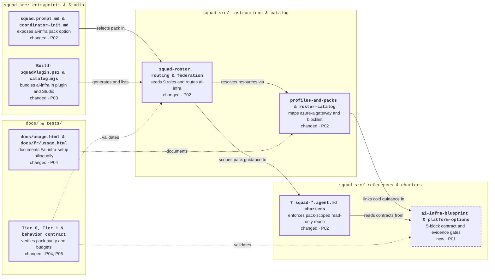

<!--
Copyright (c) Microsoft Corporation.
Licensed under the MIT license.
-->
<!-- markdownlint-disable-file -->
# RPI Plan: AI-Ready Infrastructure and AI Landing Zones Pack (`ai-infra`)

## Task Metadata

* Task ID: `issue-333`
* Task slug: `ai-infra-pack`
* Plan date: `2026-11-27`

## Executive Summary

* **Bottom line (Architecture Decision):** Ship a new opt-in **`ai-infra` pack** with **zero new catalog roles**, seeding `architect, azure-architect, iac-author, deployer, cost-manager, observability, azure-diagnose, asbuilt-author, security` (only where absent on the active profile) and pairing two cold references: `squad-src/.github/skills/squad/references/ai-infra-blueprint.md` (5-block delivery and advisory/deployment handoff contract) and `squad-src/.github/skills/squad/references/ai-infra-platform-options.md` (runtime evidence gates, shared APIM AI Gateway reach, composition with `azure-cloud` and `aks`, and blocklisted/excluded upstream candidates).
* **Why Option A wins over alternatives:** Under the three Profile-or-Pack tests in [squad-src/.github/instructions/squad/squad-roster.instructions.md](../../../../../squad-src/.github/instructions/squad/squad-roster.instructions.md), AI platform infrastructure lacks the methodology spine (not a profile), is non-exclusive across profiles and packs (`azure +ai-infra`, `azure +ai-infra +aks +azure-cloud`, `azure +ai-infra +foundry`), and answers *what platform layer it runs on*. Extending `azure` or `azure-cloud` (Option B) would impose AI Landing Zone/GPU/HPC rules on general Azure squads; extending `foundry` or `aks` (Option C) conflates application-layer agents with platform infrastructure or omits VM/CycleCloud/Slurm HPC; a blueprint-only file without a pack (Option D) fails member-scoped activation (`Packs:`), roster seeding, and preflight resource accounting.
* **Scope & Deliverables (`deliverable-fan-out`):** Eight deliverables (`D01`–`D08`) across `P01`–`P05` owned by `prompt-engineer` (`D01`–`D03`), `developer` (`D04`, `D06`), `technical-writer` (`D05`), `tester` (`D07`), and `scribe` (`D08`), with disjoint file write sets so `D02`/`D03`/`D04`/`D05` can fan out in parallel after `D01`.
* **Top Risks & Guardrails:**
  1. *Scribe `D7-5` cold core cap has **2 bytes** of headroom (82,241 / 82,243 B):* `00-index.md`, `squad-scribe.agent.md`, `scribe-cold-charter.md`, `coordinator-runtime.md` (7 B left), and `federation-runtime.md` (7 B left) are **off-limits**.
  2. *Hot-file byte ceilings:* `squad-roster.instructions.md` (**146 B** left), `squad-federation.instructions.md` (**53 B** left), and `squad.prompt.md` (**52 B** left) require in-place wording compaction when adding `ai-infra`.
  3. *Shared `azure-aigateway` isolation:* Reusing `azure-aigateway` (`microsoft/azure-skills@968f7bfaa01672e782dae2c6bab4fb9505ae047a`) across `foundry` and `ai-infra` must pass all four pack-combination and `declined`-preservation tests in `CoordinatorRuntime.Tests.ps1` and `PackRegistry.Tests.ps1`.
* **Open Decisions Needing the Human (Before Implementation):**
  * **D1 (Pack slug & role set):** Confirm pack ID `ai-infra` and `Adds (roles)` = `architect, azure-architect, iac-author, deployer, cost-manager, observability, azure-diagnose, asbuilt-author, security` *(Recommended: Approve)*.
  * **D2 (Shared Pack Resource Preflight):** Confirm `ai-infra` shares `azure-aigateway` (`968f7bf...`) as its registered opt-in skill for shared APIM AI Gateway design without requiring `foundry`, while composing with `azure-cloud` (`azure-quotas`, `cost-*`) and `aks` (`aks-gpu-inference`, `aks-cost-optimization`) rather than duplicating their rows *(Recommended: Option A — share `azure-aigateway` only; Option B also shares `azure-quotas`; Option C registers zero pack skills)*.
  * **D3 (Preview skill policy for v1):** Confirm **zero preview skills** are registered under `ai-infra` in v1 (rejecting experimental `connect-observability` and sample preview Bicep/Terraform skills) *(Recommended: Approve)*.
* **Planning result & readiness:** Complete and ready for Council review (`architect`, `security`, `cost-manager`, `challenger`) and human validation of `D1`–`D3`.

### What You May Not Know

* **Portal quota is not physical capacity:** Approved Azure subscription quota (`az quota`) confirms neither regional physical GPU/InfiniBand capacity nor commercial reservation; `ai-infra-blueprint.md` enforces five separate runtime evidence gates (SKU/family support distinguishing ND/NC/GB GPU VMs from H/HB/HC/HX CPU HPC, regional/zonal offer, quota headroom, physical placement/RDMA fabric, and commitment rate basis).
* **Advisory / PSA engagements close cleanly without code, IaC, or deployment:** Read-only specialists (`azure-architect`, `cost-manager`, `observability`, `security`, `architect`) author HLD/LLD, AI LZ topology, AVM mapping, indicative TCO, ADRs, and partner handover artifacts; `ai-infra-blueprint.md` records `iac-author`, `deployer`, and `asbuilt-author` checkpoints as explicitly `Not applicable` when the customer engagement scope is advisory-only.
* **Windows local `GATE-50` caveat:** `GATE-50` in [tests/tier0/Performance.Tests.ps1](../../../../../tests/tier0/Performance.Tests.ps1) fails locally on Windows due to OS path/CRLF handling; Linux CI is the authoritative gate for `GATE-50`, while all Tier 0 unit/packaging/budget shards and `Get-SquadContractByteCount` run locally.

### Acceptance-Criteria Traceability Matrix

| Issue #333 Acceptance Criterion | Phases & Tasks | Deliverables & Owning Roles | Requirements | Verification Commands |
|---|---|---|---|---|
| **AC-1:** Architecture decision documented (pack vs. blueprint extension) under Profile-or-Pack rules; separable from `foundry`, composable with `azure`, `aks`, `azure-cloud`, `foundry` | `P01-T01`, `P02-T01`, `P04-T01` | `D01`, `D02` (`prompt-engineer`); `D05` (`technical-writer`) | `FR-001`, `FR-002`, `NFR-001` | `Invoke-Pester -Path ./tests/tier0/PackRegistry.Tests.ps1,./tests/tier0/HotFileBudget.Tests.ps1 -Output Detailed` |
| **AC-2:** Upstream candidate skills assessed via External Cast Verification Gate at pinned SHAs; admitted skills registered `opt-in`, preview gated, rejected/superseded in blocklist | `P01-T02`, `P02-T02`, `P04-T02` | `D01`, `D02` (`prompt-engineer`); `D06` (`developer`) | `FR-003`, `FR-004`, `NFR-004` | `Invoke-Pester -Path ./tests/tier0/PackRegistry.Tests.ps1 -Output Detailed` |
| **AC-3:** Blueprint & platform-options cover AI LZ, GPU/HPC compute, AI networking & storage, GPU FinOps, and AI infra monitoring/diagnostics with role ownership, evidence tables, and `networking`/`identity` escalation | `P01-T01`, `P01-T02`, `P02-T03` | `D01`, `D03` (`prompt-engineer`) | `FR-005`, `FR-006`, `FR-007`, `NFR-003` | `Invoke-Pester -Path ./tests/tier0/Packaging.Tests.ps1,./tests/tier0/PackRegistry.Tests.ps1 -Output Detailed` |
| **AC-4:** Supports advisory/architecture-only runs (HLD/LLD, AVM map, indicative TCO, ADRs) and full IaC (`infra/{track}/{project}`) + gated deploy handoffs without violating read-only boundaries | `P01-T01`, `P02-T03`, `P04-T01`, `P04-T02` | `D01`, `D03` (`prompt-engineer`); `D05` (`technical-writer`); `D06` (`developer`) | `FR-008`, `FR-009` | `Invoke-Pester -Path ./tests/tier0/PackRegistry.Tests.ps1,./tests/tier0/CoordinatorRuntime.Tests.ps1 -Output Detailed` |
| **AC-5:** Pack discovery, roster seeding, routing, preflight/installer wiring, Studio catalog, and bilingual EN/FR docs (`docs/usage.html`, `docs/fr/usage.html`) updated together | `P02-T01`, `P02-T02`, `P03-T01`, `P03-T02`, `P04-T01` | `D02` (`prompt-engineer`); `D04` (`developer`); `D05` (`technical-writer`) | `FR-010`, `FR-011`, `NFR-005` | `npm run build && npm run check:docs && node --test tests/docs/site.test.mjs tests/tier0/squad-studio/studio.test.mjs` |
| **AC-6:** Non-adopting squads preserve behavior byte-for-byte; all Tier 0 / Tier 1 conformance, hot-file budget, packaging, and docs checks pass | `P04-T02`, `P04-T03`, `P05-T01` | `D06` (`developer`); `D07` (`tester`) | `FR-012`, `NFR-001`–`NFR-006` | `./tests/tier0/Invoke-Tier0Tests.ps1 -SourceRoot . -Shard <shard>` + `./tests/tier1/Invoke-Tier1LiveRun.ps1 -Scenario pack-lifecycle -Pack ai-infra -ProvisionOnly` |

## Phase Checklist

### After



Key: arrows point from a part to what it uses; dotted arrows, tests and docs; dashed border, new; thick border, changed; each tag names the phases that make the change.

`squad.prompt.md`, `coordinator-init.md`, `Build-SquadPlugin.ps1`, and Studio `catalog.mjs` expose the opt-in `ai-infra` pack (`P02`, `P03`), which resolves through `squad-roster.instructions.md`, `profiles-and-packs.md`, and `roster-catalog.md` (`P02`) to the new cold `ai-infra-blueprint.md` and `ai-infra-platform-options.md` references (`P01`) and seven specialist charters (`P02`). Bilingual `docs/usage.html` and `docs/fr/usage.html` plus Tier 0/Tier 1 suites and the final `Squad Reviewer` pass (`P04`, `P05`) verify the pack end to end.

<!-- rpi:phase id=P01 -->
### [ ] P01: Author Cold AI-Infra Blueprint and Platform-Options References

Goals:
* Establish the cold-path architecture, delivery, evidence, escalation, and upstream-skill contracts in `ai-infra-blueprint.md` and `ai-infra-platform-options.md` (`D01`, owned by `prompt-engineer`) with zero impact on hot-file or Scribe `D7-5` budgets.

Dependencies:
* None

Changes in the map: adds `ai-infra-blueprint.md` and `ai-infra-platform-options.md` under `squad-src/.github/skills/squad/references/` and updates cross-pack gateway wording in `foundry-blueprint.md` and `foundry-platform-options.md`.

<!-- rpi:task id=P01-T01 -->
#### [ ] P01-T01: Author `ai-infra-blueprint.md` with 5-block ownership, runtime evidence gates, `networking`/`identity` escalation, and advisory vs. deploy closure

Goals:
* Create `squad-src/.github/skills/squad/references/ai-infra-blueprint.md` defining how `ai-infra` squads plan, review, and hand off AI Landing Zones, GPU/HPC compute, AI networking/storage, GPU FinOps, and platform observability/diagnostics across both advisory-only (PSA) and full IaC/deploy engagements.

Requirements:
* `FR-001`, `FR-005`, `FR-006`, `FR-007`, `FR-008`, `FR-009`, `NFR-001`, `NFR-003`, `NFR-004`
* Research `F2`, `F3`, `D1`, `D3`: ship cold under `squad-src/.github/skills/squad/references/ai-infra-blueprint.md` with Microsoft MIT frontmatter and header; never link from `00-index.md` (`D7-5` has 2 B headroom).
* Include the mandatory **5-Block Output Contract** and **Evidence and Compatibility Contract**:
  1. *Block 1 — AI Landing Zones & Shared AI Gateway:* `azure-architect` authors management-group/subscription topology, hub-spoke/vWAN connectivity, private endpoints/DNS, network-isolated model/data zones, and shared APIM AI Gateway HLD/LLD (`docs/architecture/`); `security` owns workload authN/authZ, isolation, and threat/control surfaces; `architect` challenges trade-offs and authors ADRs.
  2. *Block 2 — AI-Ready Compute (GPU & HPC Day-0 Sizing):* `azure-architect` authors workload envelope and sizing across Azure GPU VM families (ND/NC/GB-series, explicitly distinguishing CPU HPC H/HB/HC/HX families), AKS GPU node pools & KAITO, and Azure CycleCloud / Slurm; `researcher` verifies runtime SKU/region/AVM evidence.
  3. *Block 3 — AI Networking & High-Throughput Storage:* `azure-architect` designs InfiniBand/RDMA/multi-node placement, private-link latency/egress budgets, and storage trade-offs (Azure Managed Lustre, Azure NetApp Files, Azure Blob throughput tiers) grounded in workload IOPS, throughput, metadata, and checkpointing profiles; `security` and `architect` review boundaries and NFRs.
  4. *Block 4 — GPU Utilization & FinOps Cost Modeling:* `cost-manager` models indicative TCO, queue/utilization assumptions, Spot vs. dedicated/checkpoint interruption trade-offs, and PAYG vs. Reservations/Savings Plans, explicitly distinguishing self-managed GPU VM commitments from model-endpoint Provisioned Throughput Units (PTUs).
  5. *Block 5 — AI Platform Observability, Reliability & Incident Triage:* `observability` authors read-only telemetry plans (DCGM GPU/VRAM saturation, thermal/ECC/throttling, throughput/queue depth, node/fabric/storage correlation, Azure Monitor / Managed Prometheus); `azure-diagnose` triages deployed incidents read-only; `asbuilt-author` documents post-deploy inventory/compliance/DR only after a verified live deploy.

Details:
* **Files to create:** `squad-src/.github/skills/squad/references/ai-infra-blueprint.md`.
* **Enforce the no-hard-coded SKU/region/pricing rule:** Mirror the normative clause from [squad-src/.github/skills/squad/references/foundry-platform-options.md](../../../../../squad-src/.github/skills/squad/references/foundry-platform-options.md) (`Use this reference to frame decisions, not to answer volatile product questions from memory`). Require every material claim in the blueprint's Evidence Table to record: `Claim ID & Block`, `Workload & Accelerator/Storage Envelope`, `Official Source URL / CLI Read`, `Verified On (ISO date or not verified)`, `Tenant/Subscription & Region/Zone Scope (redacted)`, `SKU/Family & GA/Preview Status`, `Quota Headroom vs. Physical Capacity Status`, `AVM Module & Version (via https://aka.ms/avm or none)`, `Verification Outcome (verified/conflicting/unverified)`, and `Customer Decision & Owner`.
* **Enforce unselectable `networking` and `identity` escalation:** Include a dedicated `## Workload vs. Enterprise Networking and Identity Boundaries` section stating that `networking` and `identity` remain unselectable in [squad-src/.github/skills/squad/references/roster-catalog.md](../../../../../squad-src/.github/skills/squad/references/roster-catalog.md); `azure-architect` and `security` own workload-scoped vNets, subnets, NSGs, private endpoints, workload-managed identities, and resource RBAC, and **must escalate** shared enterprise hub/vWAN transit, cross-subscription/on-premises DNS forwarding, IPAM allocation, forced tunneling/firewall policy, and tenant/Entra directory architecture, federation/B2B, Conditional Access, PIM, or cross-tenant entitlement policy to the user or named enterprise owner.
* **Enforce Advisory (PSA) vs. Implement/Deploy closure:** Define two explicit engagement tracks set at intake: (a) *Advisory / Architecture & Readiness Track* — delivers HLD/LLD, AI LZ topology, AVM coverage/exception map, indicative TCO, ADRs, and partner handover table with `iac-author`, `deployer`, and `asbuilt-author` checkpoints recorded as `Not applicable (advisory scope)` and zero fake deploy receipts; (b) *Implementation & Gated Deployment Track* — hands approved LLD to `iac-author` (`infra/{track}/{project}`), runs `deployer` OIDC dry-run (`what-if`/`terraform plan`) behind the human Impactful-Action Gate before live apply, and dispatches `asbuilt-author` only after verified deployment.
* **Budget/test impact:** Cold reference file (`D7-1` ships it in plugin package; `PKG-03` verifies reference links; zero bytes added to hot files or Scribe `D7-5`).
* **Verification commands:** `pwsh -NoProfile -File ./scripts/Test-SourceHeaders.ps1` and `Invoke-Pester -Path ./tests/tier0/Packaging.Tests.ps1 -Output Detailed`.

References:
* [.copilot-tracking/squad/members/issue-333/research/2026-11-27/ai-infra-pack-research.md](../research/2026-11-27/ai-infra-pack-research.md):
  * `F2`, `F3`, and `D1`–`D3` under `## Findings` and `## Decisions and Feedback`.
* [squad-src/.github/skills/squad/references/foundry-blueprint.md](../../../../../squad-src/.github/skills/squad/references/foundry-blueprint.md): structural precedent for blueprint ownership, evidence tables, and delivery checkpoints.
* [squad-src/.github/skills/squad/references/fabric-blueprint.md](../../../../../squad-src/.github/skills/squad/references/fabric-blueprint.md): precedent for separating design/local authoring from separately authorized live tenant work.

Dependencies:
* None

<!-- rpi:task id=P01-T02 -->
#### [ ] P01-T02: Author `ai-infra-platform-options.md` and align shared `azure-aigateway` wording in `foundry-blueprint.md` and `foundry-platform-options.md`

Goals:
* Create `squad-src/.github/skills/squad/references/ai-infra-platform-options.md` documenting skill routing, shared `azure-aigateway` preflight/support-file checks, cross-pack composition with `azure-cloud` and `aks`, and audited exclusions/blocklisted candidates at pinned SHAs; update `foundry-blueprint.md` and `foundry-platform-options.md` so shared `azure-aigateway` reach is coherent when either `foundry` or `ai-infra` is active.

Requirements:
* `FR-002`, `FR-003`, `FR-004`, `FR-005`, `NFR-003`, `NFR-004`
* Research `F4`, `W1`–`W9`, `D2`: keep `azure-aigateway` pinned at `microsoft/azure-skills@968f7bfaa01672e782dae2c6bab4fb9505ae047a` (`skills/azure-aigateway/SKILL.md`, directory install `apm install microsoft/azure-skills/skills/azure-aigateway#968f7bfaa01672e782dae2c6bab4fb9505ae047a --target copilot`), require packaged support files (`references/auth-best-practices.md`, `references/patterns.md`, `references/policies.md`, `references/troubleshooting.md`), and preserve `Host visibility is not selection` and `declined resource stays unavailable`.

Details:
* **Files to create/modify:**
  * Create `squad-src/.github/skills/squad/references/ai-infra-platform-options.md`.
  * Modify [squad-src/.github/skills/squad/references/foundry-blueprint.md](../../../../../squad-src/.github/skills/squad/references/foundry-blueprint.md) and [squad-src/.github/skills/squad/references/foundry-platform-options.md](../../../../../squad-src/.github/skills/squad/references/foundry-platform-options.md).
* **Required sections in `ai-infra-platform-options.md`:**
  1. *Activation & Role Delta Summary:* States `ai-infra` adds no new catalog role and reuses `architect`, `azure-architect`, `iac-author`, `deployer`, `cost-manager`, `observability`, `azure-diagnose`, `asbuilt-author`, and `security`. Lists exact role deltas per profile (`full +ai-infra` adds none; `azure +ai-infra` adds `observability`; `architecture +ai-infra` adds `asbuilt-author, azure-diagnose, deployer, iac-author, observability, security`; `operations +ai-infra` adds `architect, azure-architect, cost-manager, security`; `default +ai-infra` adds all 9 specialists). Includes mandatory guard phrases: `Host visibility is not selection`, `A declined resource stays unavailable to the squad even if the host exposes it`, `Preview is not the default`, `does not uninstall or hide a host-installed skill`, and setup links `https://microsoft.github.io/hve-squad/usage.html#ai-infra-setup` and `https://microsoft.github.io/hve-squad/fr/usage.html#ai-infra-setup`.
  2. *Paths & Cross-Pack Composition Table:* Maps requests across `Squad Azure Architect` (`azure-aigateway` when `ai-infra` or `foundry` is active; composes with `azure-quotas`, `azure-reliability`, `azure-local`, and preview `azure-local-multi-rack` when `azure-cloud` is active, and `azure-kubernetes` / `aks-gpu-inference` when `aks` is active), `Squad Cost Manager` (bundled `azure-pricing`; composes with `cost-estimation`, `cost-optimization`, `cost-analysis`, `cost-governance` via `azure-cloud` and `aks-cost-optimization` via `aks`), `Squad Observability Planner` (`telemetry-foundations` skill for DCGM/GPU/Managed Prometheus/Azure Monitor platform metrics), `Squad Azure Diagnose` (composes with `aks-gpu-inference`, `aks-troubleshooting`, `azure-diagnostics` when `aks`/`azure-cloud` are active), `Squad IaC Author` (`infra/{track}/{project}` with AVM), `Squad Deployer` (OIDC dry-run + `azure-deployment-preflight` behind Impactful-Action Gate), and `Squad As-Built Author`.
  3. *Installation, Readiness & Packaged Support Files:* Documents `Install-SquadPackResources.ps1 -Pack ai-infra`, host reload requirement, and packaged support-file check for `azure-aigateway` (`microsoft/azure-skills@968f7bfaa01672e782dae2c6bab4fb9505ae047a`), plus optional offline reference snapshot `apm_modules/.squad-pack-support/azure-skills-968f7bf`.
  4. *Official Reference Sources & Audited Exclusions / Blocklisted Candidates (`W1`–`W9`):* Cites official reference-only repositories (`Azure/AI-Landing-Zones@fa0d98a867d7e41807a6cdb34dea0a3a65ab36b1`, `Azure-Samples/ai-hub-gateway-solution-accelerator@ba0674c562099d252680d17222dc004a63019cfc`, `Azure/terraform-ai-gateway-landing-zone@dabecf2d147da2448b32b965e934babdac0f492f`, `Azure/cyclecloud-slurm@a1bebe26ab170f10f84a73c84485cf9b4686f480`, `Azure/azhpc-images@6daf57274cfb458fef7d60f6b45208e36af68790`, `Azure/azurehpc@2d57191cb35ed638525ba9424cc2aa1b5abe1c05`, `Azure/azure-netapp-files@f5733a720c7c0f2d4579bd5e4977cbc1ff2f8134`, `Azure/azure-monitor-baseline-alerts@3c1180e84e0456ae5174a1147e4422c5502964e6`, `Azure/Azure-Verified-Modules@b7ad4d6174d1a18da852eafdd12c09b3f612c845`, `<https://aka.ms/avm>`) and documents why `manage-ai-gateway`, `migrate-apim` (`Azure/aigateway@feac191bd69d7a2fa4fdba5c233f3a1d1c40fc65`), `apim-bicep`, `apim-terraform`, `apim-policies`, `apim-kql` (`Azure-Samples/AI-Gateway@98c242510ba53f4e83e5f4f19595907c8e0b36bc`), `kaito-inference`, `kaito-troubleshoot`, `kaito-workspace` (`kaito-project/kaito@fd52bbbbe528843c0724dac32f76efb81cb52a71`), `Azure/agent-landing-zone@a243267d0c7b75d25dba3a06c0819b5d86f115e0` contributor skills, `azure-compute`, `azure-storage`, `airunway-aks-setup`, `.github/plugins/azure-observability` (`microsoft/azure-skills@7847020998043c6231929b364c35393b7cdab270`), and whole-plugin forms (`ghcfa-telem` / `.mcp.json`) are excluded or blocklisted.
* **Budget/test impact:** Cold references only; zero hot-file or Scribe `D7-5` impact.
* **Verification commands:** `pwsh -NoProfile -File ./scripts/Test-SourceHeaders.ps1` and `Invoke-Pester -Path ./tests/tier0/Packaging.Tests.ps1 -Output Detailed`.

References:
* [.copilot-tracking/squad/members/issue-333/research/2026-11-27/ai-infra-pack-research.md](../research/2026-11-27/ai-infra-pack-research.md):
  * `F4` and `W1`–`W9` under `## Findings` and `### Evidence Log`.
* [squad-src/.github/skills/squad/references/azure-cloud-platform-options.md](../../../../../squad-src/.github/skills/squad/references/azure-cloud-platform-options.md): exact structural pattern for platform-options references.
* [squad-src/.github/skills/squad/references/aks-platform-options.md](../../../../../squad-src/.github/skills/squad/references/aks-platform-options.md): AKS GPU and cost composition boundary.

Dependencies:
* `P01-T01`

<!-- rpi:phase id=P02 -->
### [ ] P02: Wire Hot Instructions, Catalog Tables, Entrypoints, and Specialist Charters

Goals:
* Register `ai-infra` across canonical and mirrored pack tables, External Cast registry/blocklist, routing/federation/prompt/init entrypoints (`D02`, owned by `prompt-engineer`), and specialist agent charters (`D03`, owned by `prompt-engineer`) while staying strictly inside every hot-file byte ceiling, `PKG-03`/`PKG-04`, and Scribe `D7-5`.

Dependencies:
* `P01`

Changes in the map: updates `squad-roster.instructions.md`, `squad-routing.instructions.md`, `squad-federation.instructions.md`, `squad.prompt.md`, `coordinator-init.md`, `profiles-and-packs.md`, `roster-catalog.md`, and seven `squad-*.agent.md` charters.

<!-- rpi:task id=P02-T01 -->
#### [ ] P02-T01: Update hot instructions (`squad-roster`, `squad-routing`, `squad-federation`), `squad.prompt.md`, and `coordinator-init.md` within byte ceilings

Goals:
* Add `ai-infra` to the canonical `Registered Packs` table, routing guidance, federation pack list, CLI prompt argument hint/description, and `coordinator-init.md` offer list without exceeding any per-file byte budget in `HotFileBudget.Tests.ps1` or the 8,192 B compact-reference cap.

Requirements:
* `FR-001`, `FR-010`, `FR-012`, `NFR-001`, `NFR-002`
* Research `F1` (surfaces 3, 6–9) and `F5`:
  * [squad-src/.github/instructions/squad/squad-roster.instructions.md](../../../../../squad-src/.github/instructions/squad/squad-roster.instructions.md): max **+146 B** remaining (current 62,917 B; +878 vs baseline, max +1,024 B).
  * [squad-src/.github/instructions/squad/squad-routing.instructions.md](../../../../../squad-src/.github/instructions/squad/squad-routing.instructions.md): max **+262 B** remaining (current 29,887 B; −6 vs baseline, max +256 B).
  * [squad-src/.github/instructions/squad/squad-federation.instructions.md](../../../../../squad-src/.github/instructions/squad/squad-federation.instructions.md): max **+53 B** remaining (current 41,621 B; +203 vs baseline, max +256 B).
  * [squad-src/.github/prompts/squad/squad.prompt.md](../../../../../squad-src/.github/prompts/squad/squad.prompt.md): max **+52 B** remaining (current 7,236 B; +460 vs baseline, max +512 B with allowance).
  * [squad-src/.github/skills/squad/references/coordinator-init.md](../../../../../squad-src/.github/skills/squad/references/coordinator-init.md): max **+756 B** remaining (current 7,436 / 8,192 B).
* Canonical `Registered Packs` row contract in `squad-roster.instructions.md`:
  ```markdown
  | `ai-infra` | architect, azure-architect, iac-author, deployer, cost-manager, observability, azure-diagnose, asbuilt-author, security | `ai-infra-blueprint.md`; `ai-infra-platform-options.md` | AI Landing Zones, GPU/HPC, AI networking/storage, GPU FinOps, or AI infra observability | Opt-in. No new role |
  ```

Details:
* **Files to modify:**
  * [squad-src/.github/instructions/squad/squad-roster.instructions.md](../../../../../squad-src/.github/instructions/squad/squad-roster.instructions.md)
  * [squad-src/.github/instructions/squad/squad-routing.instructions.md](../../../../../squad-src/.github/instructions/squad/squad-routing.instructions.md)
  * [squad-src/.github/instructions/squad/squad-federation.instructions.md](../../../../../squad-src/.github/instructions/squad/squad-federation.instructions.md)
  * [squad-src/.github/prompts/squad/squad.prompt.md](../../../../../squad-src/.github/prompts/squad/squad.prompt.md)
  * [squad-src/.github/skills/squad/references/coordinator-init.md](../../../../../squad-src/.github/skills/squad/references/coordinator-init.md)
* **Byte-compaction instructions:** Because the new row in `squad-roster.instructions.md` is ~245 B while headroom is 146 B, compact ~110–140 B of non-normative prose in `squad-roster.instructions.md` (while preserving every normative heading/sentence checked by `Performance.Tests.ps1` and `PackRegistry.Tests.ps1`). In `squad-federation.instructions.md` (53 B left) and `squad.prompt.md` (52 B left), add `ai-infra` to the pack lists and trim 10–25 B of adjacent filler if needed so `Get-SquadContractByteCount` stays strictly below each ceiling. Do **not** touch `coordinator-runtime.md` (7 B left), `federation-runtime.md` (7 B left), `00-index.md` (2 B left), or any baseline JSON under `tests/tier0/baselines/`.
* **Verification commands:** `Invoke-Pester -Path ./tests/tier0/HotFileBudget.Tests.ps1,./tests/tier0/Packaging.Tests.ps1 -Output Detailed`.

References:
* [.copilot-tracking/squad/members/issue-333/research/2026-11-27/ai-infra-pack-research.md](../research/2026-11-27/ai-infra-pack-research.md):
  * `F1` and `F5` byte-budget table under `## Findings`.
* [tests/tier0/HotFileBudget.Tests.ps1](../../../../../tests/tier0/HotFileBudget.Tests.ps1): exact `Get-SquadContractByteCount` assertions.
* [tests/tier0/Performance.Tests.ps1](../../../../../tests/tier0/Performance.Tests.ps1): prompt-contract normative sentence checks.

Dependencies:
* `P01-T01`, `P01-T02`

<!-- rpi:task id=P02-T02 -->
#### [ ] P02-T02: Update `profiles-and-packs.md` and `roster-catalog.md` (mirror row, Pack Discovery, Pack Resource Preflight, shared `azure-aigateway` membership, and External Cast Blocklist)

Goals:
* Mirror `ai-infra` in `profiles-and-packs.md` (`Registered Packs`, `Pack Discovery`, `Pack Resource Preflight`, and preflight reading guidance) and update `roster-catalog.md` (`azure-aigateway` prerequisites prose, `Registered Pack Skills`, verification narrative, and `External Cast Blocklist` entries at pinned SHAs).

Requirements:
* `FR-001`, `FR-002`, `FR-003`, `FR-004`, `FR-010`, `NFR-004`
* Research `F1` (surfaces 4–5), `F4`, `C3`, `C4`, `W1`–`W9`:
  * In [squad-src/.github/skills/squad/references/profiles-and-packs.md](../../../../../squad-src/.github/skills/squad/references/profiles-and-packs.md), add `ai-infra` to `Registered Packs` (matching `Adds` and `Guidance`: `[ai-infra-blueprint.md](ai-infra-blueprint.md); [ai-infra-platform-options.md](ai-infra-platform-options.md)`), `PackResourcePreflight` (`| ai-infra | azure-aigateway |`), `Pack Discovery`, and add the `For ai-infra, read [ai-infra-platform-options.md](ai-infra-platform-options.md) before asking to install resources...` paragraph.
  * In [squad-src/.github/skills/squad/references/roster-catalog.md](../../../../../squad-src/.github/skills/squad/references/roster-catalog.md):
    1. Keep the single canonical `azure-aigateway` row in `Registered External Cast` pinned at `microsoft/azure-skills@968f7bfaa01672e782dae2c6bab4fb9505ae047a` (`Verified On: 2026-11-15`), updating its `Prerequisites` column to preserve the substring ``Reach only while `foundry` is active`` while adding `ai-infra` reach (e.g., ``Reach only while `foundry` is active (or while `ai-infra` is active for shared APIM AI gateway platform design). Do not auto-install``) so existing `Foundry pack-aware selection` and new `ai-infra` tests both pass.
    2. Add `| ai-infra | azure-aigateway |` to `Registered Pack Skills`.
    3. Add an `#### AI-Ready Infrastructure and AI Landing Zones verification` subsection under `### External Cast` documenting the gate outcomes at pinned SHAs (`W1`–`W9`).
    4. Record rejected/superseded candidates in `External Cast Blocklist` with exact failing gate checks and ISO date `2026-11-27`: `manage-ai-gateway` and `migrate-apim` (`Azure/aigateway@feac191bd69d7a2fa4fdba5c233f3a1d1c40fc65` — live resource mutation/cross-product migration violating read-only `azure-architect` boundary), `apim-bicep`, `apim-terraform`, `apim-policies`, `apim-kql` (`Azure-Samples/AI-Gateway@98c242510ba53f4e83e5f4f19595907c8e0b36bc` — sample-scoped preview Bicep/Terraform/KQL overlapping AVM and `azure-aigateway`), `kaito-inference` and `kaito-troubleshoot` (`kaito-project/kaito@fd52bbbbe528843c0724dac32f76efb81cb52a71` — non-Microsoft origin namespace, cluster provisioning in `kaito-inference`, and collision with official `aks-gpu-inference`), and `Azure/agent-landing-zone` contributor skills (`architecture-decision`, `engineering-principles`, `documentation-consistency`, `multi-repo-release` at `a243267d0c7b75d25dba3a06c0819b5d86f115e0` — repo-internal contributor workflow colliding with HVE Core ADR/review skills).

Details:
* **Files to modify:**
  * [squad-src/.github/skills/squad/references/profiles-and-packs.md](../../../../../squad-src/.github/skills/squad/references/profiles-and-packs.md)
  * [squad-src/.github/skills/squad/references/roster-catalog.md](../../../../../squad-src/.github/skills/squad/references/roster-catalog.md)
* **Update `last_updated` frontmatter** in `profiles-and-packs.md` and `roster-catalog.md` to `"2026-11-27"` (all existing `Verified On` dates in `roster-catalog.md` are between `2026-11-11` and `2026-11-23`, well within the 90-day backstop of `2026-11-27`).
* **Budget/test impact:** Cold reference files (`profiles-and-packs.md` and `roster-catalog.md` are not in the hot-file set or Scribe `D7-5` cold core).
* **Verification commands:** `Invoke-Pester -Path ./tests/tier0/PackRegistry.Tests.ps1,./tests/tier0/Packaging.Tests.ps1 -Output Detailed`.

References:
* [.copilot-tracking/squad/members/issue-333/research/2026-11-27/ai-infra-pack-research.md](../research/2026-11-27/ai-infra-pack-research.md):
  * `F4`, `C3`, `C4`, and `W1`–`W9` under `## Findings` and `### Evidence Log`.
* [squad-src/.github/skills/squad/references/roster-catalog.md](../../../../../squad-src/.github/skills/squad/references/roster-catalog.md): `Registered External Cast`, `Registered Pack Skills`, and `External Cast Blocklist` tables.
* [tests/tier0/PackRegistry.Tests.ps1](../../../../../tests/tier0/PackRegistry.Tests.ps1): table-parity and 90-day backstop checks.

Dependencies:
* `P01-T01`, `P01-T02`, `P02-T01`

<!-- rpi:task id=P02-T03 -->
#### [ ] P02-T03: Add compact `ai-infra` guidance pointers and read-only/gated boundaries to the 7 `Squad` specialist charters

Goals:
* Wire `ai-infra-blueprint.md` and `ai-infra-platform-options.md` into the seven `Squad`-owned specialist charters (`D03`, owned by `prompt-engineer`) so explicit reach, non-declined resource guards, packaged support-file checks, no-hard-coded-SKU rules, and read-only/gated boundaries are enforced deterministically.

Requirements:
* `FR-005`, `FR-006`, `FR-007`, `FR-008`, `FR-009`, `NFR-002`, `NFR-003`
* Research `F1` (Conditional A), `F3`, `F5`, `C6`:
  * Stay well under `PKG-04` 30,000-char body cap (`azure-architect` currently 13,768 chars; `cost-manager` 18,048; `azure-diagnose` 16,239; `deployer` 11,437; `asbuilt-author` 9,560; `observability-planner` 9,374; `iac-author` 6,979).
  * Note: `architect` (`System Architecture Reviewer`) and `security` (`Security Planner`) are deployed HVE Core agents (not edited in `squad-src/.github/agents/squad/`) and receive `ai-infra-blueprint.md` section pointers via coordinator dispatch.

Details:
* **Files to modify:**
  * [squad-src/.github/agents/squad/squad-azure-architect.agent.md](../../../../../squad-src/.github/agents/squad/squad-azure-architect.agent.md): add `ai-infra-blueprint.md` / `ai-infra-platform-options.md` pointer for AI Landing Zones, shared APIM AI Gateway (`azure-aigateway` active under `foundry` or `ai-infra` when not `declined` and support files exist), GPU/HPC VM vs. CPU HPC distinction, AKS GPU/KAITO, CycleCloud/Slurm, InfiniBand/RDMA, Managed Lustre/ANF/Blob, runtime evidence verification (`azure-quotas` when `azure-cloud` is active), and escalation of enterprise `networking`/`identity`.
  * [squad-src/.github/agents/squad/squad-cost-manager.agent.md](../../../../../squad-src/.github/agents/squad/squad-cost-manager.agent.md): add `ai-infra` GPU FinOps pointer (indicative TCO, PTU vs. self-managed GPU VM Reservations/Savings Plans/PAYG, Spot vs. dedicated checkpointing economics, idle GPU detection, composing with `azure-cloud` and `aks-cost-optimization` only while those packs are active and not `declined`).
  * [squad-src/.github/agents/squad/squad-observability-planner.agent.md](../../../../../squad-src/.github/agents/squad/squad-observability-planner.agent.md): add `ai-infra` platform telemetry pointer (read-only DCGM GPU/VRAM saturation, thermal/ECC/throttling, throughput/queue depth, node/fabric/storage correlation, Azure Monitor / Managed Prometheus without enabling live collection or installing agents).
  * [squad-src/.github/agents/squad/squad-azure-diagnose.agent.md](../../../../../squad-src/.github/agents/squad/squad-azure-diagnose.agent.md): add `ai-infra` read-only GPU/HPC/storage/gateway incident triage pointer (correlating throttling, Xid/ECC, fabric/storage bottlenecks, and composing with `aks-gpu-inference`/`azure-diagnostics` when active without mutating nodes or workloads).
  * [squad-src/.github/agents/squad/squad-iac-author.agent.md](../../../../../squad-src/.github/agents/squad/squad-iac-author.agent.md): add compact `ai-infra` pointer for converting approved AI LZ / GPU / storage LLDs into AVM-first Bicep/Terraform under `infra/{track}/{project}` only when the engagement selects the implementation track (skipped on advisory-only runs).
  * [squad-src/.github/agents/squad/squad-deployer.agent.md](../../../../../squad-src/.github/agents/squad/squad-deployer.agent.md): add compact `ai-infra` pointer keeping OIDC dry-run (`what-if`/`plan`), `azure-deployment-preflight`, optional read-only `azure-quotas` check (when `azure-cloud` is active), and the human Impactful-Action Gate without chaining into blocklisted `azure-prepare`/`azure-validate`/`azure-deploy` or `manage-ai-gateway`.
  * [squad-src/.github/agents/squad/squad-asbuilt-author.agent.md](../../../../../squad-src/.github/agents/squad/squad-asbuilt-author.agent.md): add compact `ai-infra` pointer documenting post-deploy AI LZ / GPU estate inventory, compliance matrix, operations runbook, and DR plan only after a verified deployment (never fabricating as-built facts on advisory-only engagements).
* **Budget/test impact:** Each charter addition is ~400–900 characters, leaving >11,000 characters of `PKG-04` headroom on every modified agent and 0 B impact on hot files or `D7-5`.
* **Verification commands:** `Invoke-Pester -Path ./tests/tier0/Packaging.Tests.ps1,./tests/tier0/PackRegistry.Tests.ps1 -Output Detailed`.

References:
* [.copilot-tracking/squad/members/issue-333/research/2026-11-27/ai-infra-pack-research.md](../research/2026-11-27/ai-infra-pack-research.md):
  * `F1` (Conditional A), `F3`, `F5`, and `C6`.
* [tests/tier0/Packaging.Tests.ps1](../../../../../tests/tier0/Packaging.Tests.ps1): `PKG-03` and `PKG-04` body length and reference checks.

Dependencies:
* `P01-T01`, `P01-T02`

<!-- rpi:phase id=P03 -->
### [ ] P03: Update Plugin Builder, Squad Studio Catalog, and Release Fragment

Goals:
* Align the generated `squad-run` skill in `scripts/Build-SquadPlugin.ps1`, add the optional `ai-infra` card to Squad Studio (`lib/catalog.mjs` and `README.md`), and record the `.changes/unreleased/` release fragment (`D04`, owned by `developer`).

Dependencies:
* `P02`

Changes in the map: updates `scripts/Build-SquadPlugin.ps1`, `squad-src/.github/skills/squad/extensions/hve-squad-studio/lib/catalog.mjs`, `squad-src/.github/skills/squad/extensions/hve-squad-studio/README.md`, and adds `.changes/unreleased/20261127-ai-infra-pack.md`.

<!-- rpi:task id=P03-T01 -->
#### [ ] P03-T01: Update `scripts/Build-SquadPlugin.ps1` and verify runtime script compatibility

Goals:
* Add `ai-infra` to the generated `squad-run` skill's literal pack list in `scripts/Build-SquadPlugin.ps1` and verify that `Get-SquadInitContext.ps1`, `SquadCoordinator.psm1`, and `Install-SquadPackResources.ps1` discover `ai-infra`, its two cold references, and its shared `azure-aigateway` resource without production script changes.

Requirements:
* `FR-002`, `FR-010`, `FR-012`, `NFR-002`
* Research `F1` (surface 10, Conditional B) and `C4`: `Get-SquadPackResourceInventory` in [squad-src/.github/skills/squad/scripts/SquadCoordinator.psm1](../../../../../squad-src/.github/skills/squad/scripts/SquadCoordinator.psm1) is already table-driven and deduplicates shared resources across packs via `$inventory[$resourceName].packs.Add($packName)`.

Details:
* **Files to modify:**
  * [scripts/Build-SquadPlugin.ps1](../../../../../scripts/Build-SquadPlugin.ps1): update the `squad-run` template's `**pack** (optional)` bullet to include `` `ai-infra` `` alongside the existing nine packs.
* **Runtime script verification (no edit expected unless a test exposes a gap):** Run `Get-SquadInitContext.ps1` and `Build-SquadPlugin.ps1` against a disposable output directory to confirm `ai-infra-blueprint.md` and `ai-infra-platform-options.md` are copied into the built plugin (`D7-1`) and `Get-SquadPackResourceInventory` returns `azure-aigateway` with `packs = @('ai-infra')` when `-Pack @('ai-infra')` is passed and `packs = @('foundry', 'ai-infra')` when `-Pack @('foundry', 'ai-infra')` is passed.
* **Verification commands:**
  * `Invoke-Pester -Path ./tests/tier0/Build-SquadPlugin.Tests.ps1,./tests/tier0/Packaging.Tests.ps1 -Output Detailed`
  * `Invoke-ScriptAnalyzer -Path ./scripts/Build-SquadPlugin.ps1 -Settings ./PSScriptAnalyzerSettings.psd1`

References:
* [.copilot-tracking/squad/members/issue-333/research/2026-11-27/ai-infra-pack-research.md](../research/2026-11-27/ai-infra-pack-research.md):
  * `F1` (surface 10 and Conditional B) and `C4`.
* [scripts/Build-SquadPlugin.ps1](../../../../../scripts/Build-SquadPlugin.ps1): generated `squad-run` skill definition.
* [squad-src/.github/skills/squad/scripts/SquadCoordinator.psm1](../../../../../squad-src/.github/skills/squad/scripts/SquadCoordinator.psm1): `Get-SquadPackResourceInventory` and `Assert-SquadPackResourceDecisions`.

Dependencies:
* `P02-T01`, `P02-T02`

<!-- rpi:task id=P03-T02 -->
#### [ ] P03-T02: Add `ai-infra` to Squad Studio (`lib/catalog.mjs`, `README.md`) and create `.changes/unreleased/20261127-ai-infra-pack.md`

Goals:
* Expose `ai-infra` as an optional, non-default pack in Squad Studio's `PACK_OPTIONS` catalog and documentation, and add the unreleased changelog fragment (`D04`, owned by `developer`).

Requirements:
* `FR-010`, `FR-011`, `NFR-004`
* Research `F1` (surfaces 11–12, 15): follow the `034f51916baa87a8383e53df17850f2febd133d5` (`#282` Azure Cloud) precedent; do not hand-edit `CHANGELOG.md`.

Details:
* **Files to create/modify:**
  * Modify [squad-src/.github/skills/squad/extensions/hve-squad-studio/lib/catalog.mjs](../../../../../squad-src/.github/skills/squad/extensions/hve-squad-studio/lib/catalog.mjs): add the `ai-infra` entry to `PACK_OPTIONS` (`id: 'ai-infra'`, `title: 'AI-Ready Infrastructure & Landing Zones'`, `plainWhy: 'Adds Azure AI landing zone, GPU/HPC sizing, high-throughput storage, GPU FinOps, and platform observability specialists.'`, `hasPreview: false`, `previewNote: ''`, `keywords: /\b(ai\s+landing\s+zone|ai\s+infra|gpu\s+cluster|hpc\b|slurm\b|cyclecloud|infiniband|rdma\b|managed\s+lustre|dcgm\b|kaito\b)\b/i`), keeping it unselected by default.
  * Modify [squad-src/.github/skills/squad/extensions/hve-squad-studio/README.md](../../../../../squad-src/.github/skills/squad/extensions/hve-squad-studio/README.md): list `ai-infra` in the supported packs overview.
  * Create `.changes/unreleased/20261127-ai-infra-pack.md` summarizing the new opt-in `ai-infra` pack, `ai-infra-blueprint.md`, `ai-infra-platform-options.md`, shared `azure-aigateway` reach, and External Cast Blocklist additions.
  * Create and maintain `.copilot-tracking/squad/members/issue-333/changes/2026-11-27/ai-infra-pack-changes.md` during implementation.
* **Verification commands:** `node --test squad-src/.github/skills/squad/extensions/hve-squad-studio/studio.test.mjs tests/tier0/squad-studio/studio.test.mjs`.

References:
* [.copilot-tracking/squad/members/issue-333/research/2026-11-27/ai-infra-pack-research.md](../research/2026-11-27/ai-infra-pack-research.md):
  * `F1` (surfaces 11–12, 15).
* [squad-src/.github/skills/squad/extensions/hve-squad-studio/lib/catalog.mjs](../../../../../squad-src/.github/skills/squad/extensions/hve-squad-studio/lib/catalog.mjs): `PACK_OPTIONS` array contract.

Dependencies:
* `P02-T01`, `P02-T02`

<!-- rpi:phase id=P04 -->
### [ ] P04: Author Bilingual Documentation and Expand Tier 0 / Tier 1 Test Suites

Goals:
* Document `ai-infra` bilingually in `docs/usage.html` and `docs/fr/usage.html` (`D05`, owned by `technical-writer`) and add comprehensive regression/isolation tests across `tests/squad-behavior-contract.md`, Tier 0 Pester/Node suites, and Tier 1 pack-lifecycle (`D06`, owned by `developer`).

Dependencies:
* `P02`, `P03`

Changes in the map: updates `docs/usage.html`, `docs/fr/usage.html`, `tests/squad-behavior-contract.md`, and seven Tier 0 test files plus Tier 1 `pack-lifecycle` verification.

<!-- rpi:task id=P04-T01 -->
#### [ ] P04-T01: Update bilingual `docs/usage.html` and `docs/fr/usage.html` with `#ai-infra-setup` and byte-identical code blocks

Goals:
* Add the `ai-infra` pack row, `#ai-infra-setup` section, composition recipes (`azure +ai-infra`, `azure +ai-infra +aks +azure-cloud`, `azure +ai-infra +foundry`), and advisory vs. gated-deploy examples to both English and French usage pages (`D05`, owned by `technical-writer`).

Requirements:
* `FR-008`, `FR-011`, `NFR-005`
* Research `F1` (surfaces 13–14, 24, Conditional C) and `C10`:
  * Both [docs/usage.html](../../../../../docs/usage.html) and [docs/fr/usage.html](../../../../../docs/fr/usage.html) must contain `<td ...><code>ai-infra</code></td>` in the Registered Packs table and a matching `id="ai-infra-setup"` section anchor.
  * Every `<pre><code>` block added to `docs/usage.html` and `docs/fr/usage.html` must be **byte-for-byte identical** across English and French so [tests/docs/site.test.mjs](../../../../../tests/docs/site.test.mjs) and [scripts/check-docs.mjs](../../../../../scripts/check-docs.mjs) pass.

Details:
* **Files to modify:**
  * [docs/usage.html](../../../../../docs/usage.html)
  * [docs/fr/usage.html](../../../../../docs/fr/usage.html)
* **Content to include in both EN and FR:**
  1. Registered Packs table row for `<code>ai-infra</code>` listing its 9 roles, `[ai-infra-blueprint.md]` / `[ai-infra-platform-options.md]`, and `#ai-infra-setup` link.
  2. `<section id="ai-infra-setup">` (or matching heading anchor) covering: shared APIM AI Gateway skill install (`apm install microsoft/azure-skills/skills/azure-aigateway#968f7bfaa01672e782dae2c6bab4fb9505ae047a --target copilot`), `Install-SquadPackResources.ps1 -Pack ai-infra`, host reload, optional snapshot `apm_modules/.squad-pack-support/azure-skills-968f7bf`, composition with `azure-cloud` (`azure-quotas`, `cost-*`) and `aks` (`aks-gpu-inference`, `aks-cost-optimization`), advisory-only (PSA) handover vs. gated IaC/deploy flow, and enterprise `networking`/`identity` escalation.
  3. Do not edit `site/` templates unless a test requires it (`site/` builds directly from `docs/`).
* **Verification commands:** `npm run build && npm run check:docs && node --test tests/docs/site.test.mjs`.

References:
* [.copilot-tracking/squad/members/issue-333/research/2026-11-27/ai-infra-pack-research.md](../research/2026-11-27/ai-infra-pack-research.md):
  * `F1` (surfaces 13–14, 24) and `C10`.
* [docs/usage.html](../../../../../docs/usage.html): `#azure-cloud-setup` and `#foundry-setup` sections.
* [docs/fr/usage.html](../../../../../docs/fr/usage.html): French parity sections.
* [tests/docs/site.test.mjs](../../../../../tests/docs/site.test.mjs) and [scripts/check-docs.mjs](../../../../../scripts/check-docs.mjs): anchor and code-block parity checks.

Dependencies:
* `P02-T01`, `P02-T02`

<!-- rpi:task id=P04-T02 -->
#### [ ] P04-T02: Update `tests/squad-behavior-contract.md` and Tier 0 unit suites (`PackRegistry`, `CoordinatorRuntime`, `ExpandSquadRoster`, `InitializeSquadFederation`, `WatchMode`, `Packaging`, `studio.test.mjs`)

Goals:
* Add deterministic Tier 0 test coverage (`D06`, owned by `developer`) proving `ai-infra` table/mirror/prompt/federation/docs parity, shared `azure-aigateway` 4-way pack isolation (`foundry`-only, `ai-infra`-only, `foundry + ai-infra`, neither), `declined` preservation, role deduplication across profiles, federation member opt-in, Watch Mode non-interactive fail-closed behavior, `D7-1` reference packaging without `00-index.md`, and no-hard-coded-SKU/pricing guardrails.

Requirements:
* `FR-001`–`FR-012`, `NFR-001`–`NFR-006`
* Research `F1` (surfaces 16–22), `F5`, `C8`, `C9`:
  * Lock test ownership: `developer` (`Squad Implementor`) updates all test files in `D06`; `tester` (`Squad Reviewer`) executes and verifies them read-only in `P05`.
  * Exact test removals: `none` (preserve all existing Tier 0 and Tier 1 test cases).

Details:
* **Files to modify:**
  * [tests/squad-behavior-contract.md](../../../../../tests/squad-behavior-contract.md): add `ai-infra` pack contract assertions (role set, shared `azure-aigateway` isolation, advisory vs. deploy boundary, `networking`/`identity` escalation, and Tier 1 `-Pack ai-infra` parameterization).
  * [tests/tier0/PackRegistry.Tests.ps1](../../../../../tests/tier0/PackRegistry.Tests.ps1): add `Describe 'AI-Ready Infrastructure and AI Landing Zones official pack'` verifying:
    1. `ai-infra` role set (`architect,asbuilt-author,azure-architect,azure-diagnose,cost-manager,deployer,iac-author,observability,security`) matches between `squad-roster.instructions.md` and `profiles-and-packs.md`, adds zero roles to `full`, adds only `observability` to `azure`, and leaves all 11 base profiles unchanged.
    2. `azure-aigateway` maps to both `foundry` and `ai-infra` in `Registered Pack Skills` and `Pack Resource Preflight` while keeping a single canonical row in `Registered External Cast` pinned at `968f7bfaa01672e782dae2c6bab4fb9505ae047a`.
    3. Blocklist contains `manage-ai-gateway`, `migrate-apim`, `apim-bicep`, `apim-terraform`, `apim-policies`, `apim-kql`, `kaito-inference`, `kaito-troubleshoot`, and `Azure/agent-landing-zone` skills, while keeping `azure-deployment-preflight`, `azure-pricing`, `azure-quotas`, and `aks-gpu-inference` unblocked.
    4. Charter guard phrases (`ai-infra-blueprint.md`, `ai-infra-platform-options.md`, `Host visibility is not selection`, `declined resource stays unavailable`, `Not applicable`, `#ai-infra-setup`) and absence of hard-coded GPU price tables in `ai-infra-blueprint.md` and `ai-infra-platform-options.md`.
  * [tests/tier0/CoordinatorRuntime.Tests.ps1](../../../../../tests/tier0/CoordinatorRuntime.Tests.ps1): test `Get-SquadPackResourceInventory` and `Assert-SquadPackResourceDecisions` across all 4 combinations (`foundry` only, `ai-infra` only, `foundry + ai-infra`, neither) and verify that `declined` on `azure-aigateway` is honored even when `-AvailableSkill @('azure-aigateway')` is passed.
  * [tests/tier0/ExpandSquadRoster.Tests.ps1](../../../../../tests/tier0/ExpandSquadRoster.Tests.ps1): test mid-project `ai-infra` expansion on `azure` (adds `observability` only), `full` (adds 0 roles, updates `Packs:`), and removal when `foundry` or `azure-cloud` is also active (shared roles survive).
  * [tests/tier0/InitializeSquadFederation.Tests.ps1](../../../../../tests/tier0/InitializeSquadFederation.Tests.ps1): test federation member initialization with `ai-infra` without mutating sibling sub-squads.
  * [tests/tier0/WatchMode.Tests.ps1](../../../../../tests/tier0/WatchMode.Tests.ps1): verify unattended Watch Mode never auto-installs `ai-infra` pack resources.
  * [tests/tier0/Packaging.Tests.ps1](../../../../../tests/tier0/Packaging.Tests.ps1): verify `D7-1` ships `ai-infra-blueprint.md` and `ai-infra-platform-options.md` while `D7-5` Scribe cold core remains `<= 82,243` B (`00-index.md` untouched).
  * [tests/tier0/squad-studio/studio.test.mjs](../../../../../tests/tier0/squad-studio/studio.test.mjs): assert `ai-infra` appears in `PACK_OPTIONS` and is not selected by default.
* **Verification commands:**
  * `$env:TIER0_BASE_SHA = (git merge-base HEAD origin/main); pwsh -NoProfile -File ./tests/tier0/Invoke-Tier0Tests.ps1 -SourceRoot . -Shard routing-and-PackRegistry`
  * `pwsh -NoProfile -File ./tests/tier0/Invoke-Tier0Tests.ps1 -SourceRoot . -Shard coordinator-and-federation`
  * `pwsh -NoProfile -File ./tests/tier0/Invoke-Tier0Tests.ps1 -SourceRoot . -Shard packaging`
  * `node --test tests/tier0/squad-studio/studio.test.mjs`

References:
* [.copilot-tracking/squad/members/issue-333/research/2026-11-27/ai-infra-pack-research.md](../research/2026-11-27/ai-infra-pack-research.md):
  * `F1` (surfaces 16–22), `F5`, `C8`, and `C9`.
* [tests/tier0/PackRegistry.Tests.ps1](../../../../../tests/tier0/PackRegistry.Tests.ps1): existing pack test suites.
* [tests/tier0/CoordinatorRuntime.Tests.ps1](../../../../../tests/tier0/CoordinatorRuntime.Tests.ps1): pack resource inventory and decision tests.

Dependencies:
* `P02-T01`, `P02-T02`, `P02-T03`, `P03-T01`, `P03-T02`, `P04-T01`

<!-- rpi:task id=P04-T03 -->
#### [ ] P04-T03: Verify Tier 1 `pack-lifecycle` scenario parameterization for `ai-infra` and backwards-compatibility proof

Goals:
* Verify that [tests/tier1/Invoke-Tier1LiveRun.ps1](../../../../../tests/tier1/Invoke-Tier1LiveRun.ps1) accepts `-Scenario pack-lifecycle -Pack ai-infra -ProvisionOnly` via its table-driven pack parser without duplicating `scenarios/pack-lifecycle.json`, and run the backwards-compatibility check confirming non-adopting squads are byte-for-byte unchanged.

Requirements:
* `FR-012`, `NFR-006`
* Research `F1` (surface 23), `F5`, `C9`: `Invoke-Tier1LiveRun.ps1` dynamically parses registered pack names from `squad-roster.instructions.md`; clean up any provisioned fixture directory after `-ProvisionOnly` verification.

Details:
* **Files to verify (and modify only if `-Pack ai-infra` requires an explicit parameter allowlist update):**
  * [tests/tier1/Invoke-Tier1LiveRun.ps1](../../../../../tests/tier1/Invoke-Tier1LiveRun.ps1)
  * [tests/tier1/scenarios/pack-lifecycle.json](../../../../../tests/tier1/scenarios/pack-lifecycle.json)
* **Backwards-compatibility proof commands:**
  1. Run `Get-SquadInitContext.ps1 -RepoRoot .` with no `-Pack` and verify `packResources` count is `0` and all 11 profile role lists are byte-for-byte identical to pre-change baseline.
  2. Confirm `git diff -- tests/tier0/baselines/ apm.yml squad-src/.github/skills/squad/references/00-index.md` is empty.
  3. Run `pwsh -NoProfile -File ./tests/tier1/Invoke-Tier1LiveRun.ps1 -Scenario pack-lifecycle -Pack ai-infra -ProvisionOnly` targeting a temp workdir outside the repo tree.

References:
* [.copilot-tracking/squad/members/issue-333/research/2026-11-27/ai-infra-pack-research.md](../research/2026-11-27/ai-infra-pack-research.md):
  * `F1` (surface 23), `F5`, and `C9`.
* [tests/tier1/Invoke-Tier1LiveRun.ps1](../../../../../tests/tier1/Invoke-Tier1LiveRun.ps1): `-Scenario pack-lifecycle -Pack <name>` harness.

Dependencies:
* `P04-T02`

<!-- rpi:phase id=P05 -->
### [ ] P05: Execute Full Validation Sequence and Squad Reviewer Stage

Goals:
* Run the complete validation sequence across all Tier 0 shards, docs checks, source headers, and PSScriptAnalyzer, then dispatch `tester` (`Squad Reviewer`) to produce `.copilot-tracking/squad/members/issue-333/reviews/2026-11-27/ai-infra-pack-review.md` (`D07`) and `scribe` (`D08`) to persist state.

Dependencies:
* `P01`, `P02`, `P03`, `P04`

Changes in the map: completes validation of `Tier 0, Tier 1 & behavior contract` and records the `Squad Reviewer` review artifact.

<!-- rpi:task id=P05-T01 -->
#### [ ] P05-T01: Run validation suite and dispatch `Squad Reviewer` (`tester`) for implementation-versus-plan conformance review

Goals:
* Verify all repository checks pass (accounting for the known Windows-only `GATE-50` caveat) and produce the severity-graded review artifact `.copilot-tracking/squad/members/issue-333/reviews/2026-11-27/ai-infra-pack-review.md` (`D07`, owned by `tester`).

Requirements:
* `FR-001`–`FR-012`, `NFR-001`–`NFR-006`
* Every acceptance criterion (`AC-1`–`AC-6`) must have passing test evidence recorded in `.copilot-tracking/squad/members/issue-333/reviews/2026-11-27/ai-infra-pack-review.md`.

Details:
* **Validation sequence (run in order before dispatching `tester`):**
  1. Source headers: `pwsh -NoProfile -File ./scripts/Test-SourceHeaders.ps1`
  2. PSScriptAnalyzer: `Invoke-ScriptAnalyzer -Path ./scripts,./squad-src,./tests -Settings ./PSScriptAnalyzerSettings.psd1 -Recurse`
  3. Hot-file & packaging budgets: `Invoke-Pester -Path ./tests/tier0/HotFileBudget.Tests.ps1,./tests/tier0/Packaging.Tests.ps1,./tests/tier0/PackRegistry.Tests.ps1 -Output Detailed`
  4. Tier 0 shards (with `$env:TIER0_BASE_SHA = (git merge-base HEAD origin/main)`):
     * `pwsh -NoProfile -File ./tests/tier0/Invoke-Tier0Tests.ps1 -SourceRoot . -Shard packaging`
     * `pwsh -NoProfile -File ./tests/tier0/Invoke-Tier0Tests.ps1 -SourceRoot . -Shard routing-and-PackRegistry`
     * `pwsh -NoProfile -File ./tests/tier0/Invoke-Tier0Tests.ps1 -SourceRoot . -Shard coordinator-and-federation`
     * `pwsh -NoProfile -File ./tests/tier0/Invoke-Tier0Tests.ps1 -SourceRoot . -Shard scribe-and-state`
     * `pwsh -NoProfile -File ./tests/tier0/Invoke-Tier0Tests.ps1 -SourceRoot . -Shard studio-and-cli`
     * *(Note: `GATE-50` in `Performance.Tests.ps1` fails locally on Windows only; verify all other `Performance.Tests.ps1` cases locally and rely on Linux CI for `GATE-50`.)*
  5. Studio & Docs build/check: `node --test squad-src/.github/skills/squad/extensions/hve-squad-studio/studio.test.mjs tests/tier0/squad-studio/studio.test.mjs && npm run build && npm run check:docs && node --test tests/docs/site.test.mjs`
  6. Tier 1 provision check: `pwsh -NoProfile -File ./tests/tier1/Invoke-Tier1LiveRun.ps1 -Scenario pack-lifecycle -Pack ai-infra -ProvisionOnly` (in temp directory).
* **Dispatch `tester` (`Squad Reviewer`):** Review git diff against `.copilot-tracking/squad/members/issue-333/plans/ai-infra-pack-plan.md` and write `.copilot-tracking/squad/members/issue-333/reviews/2026-11-27/ai-infra-pack-review.md`.

References:
* [tests/tier0/Invoke-Tier0Tests.ps1](../../../../../tests/tier0/Invoke-Tier0Tests.ps1): Tier 0 shard runner.
* [tests/tier0/Tier0TestPlan.psm1](../../../../../tests/tier0/Tier0TestPlan.psm1): shard definitions.
* [scripts/Test-SourceHeaders.ps1](../../../../../scripts/Test-SourceHeaders.ps1): MIT header checker.
* [PSScriptAnalyzerSettings.psd1](../../../../../PSScriptAnalyzerSettings.psd1): PowerShell lint rules.

Dependencies:
* `P04-T01`, `P04-T02`, `P04-T03`

## Deliverables, Role Ownership, Non-Participating Roles, and Fan-Out Order

### Deliverable Schedule (`deliverable-fan-out`)

Because three distinct artifact-owning implementation roles (`prompt-engineer`, `developer`, `technical-writer`) own deliverables across disjoint write sets before `tester` (`Squad Reviewer`) reviews the result, the **Implement Shape is `deliverable-fan-out`**.

| ID | Deliverable | Owning Role (Roster Primary) | Exact Write Set (Repo Source / Tracking Paths) | Phase / Tasks | Depends On | Parallel Batch |
|---|---|---|---|---|---|---|
| **D01** | Cold AI-Infra Blueprint & Platform-Options References + Foundry gateway cross-ref alignment | `prompt-engineer` (`Squad Prompt Engineer`) | `squad-src/.github/skills/squad/references/ai-infra-blueprint.md` (new), `squad-src/.github/skills/squad/references/ai-infra-platform-options.md` (new), [squad-src/.github/skills/squad/references/foundry-blueprint.md](../../../../../squad-src/.github/skills/squad/references/foundry-blueprint.md), [squad-src/.github/skills/squad/references/foundry-platform-options.md](../../../../../squad-src/.github/skills/squad/references/foundry-platform-options.md) | `P01-T01`, `P01-T02` | Human approval of `D1`–`D3` | **Batch 1** |
| **D02** | Hot Instructions, CLI Prompt, Coordinator Init, Profiles/Packs Mirror, and External Cast Registry/Blocklist | `prompt-engineer` (`Squad Prompt Engineer`) | [squad-src/.github/instructions/squad/squad-roster.instructions.md](../../../../../squad-src/.github/instructions/squad/squad-roster.instructions.md), [squad-src/.github/instructions/squad/squad-routing.instructions.md](../../../../../squad-src/.github/instructions/squad/squad-routing.instructions.md), [squad-src/.github/instructions/squad/squad-federation.instructions.md](../../../../../squad-src/.github/instructions/squad/squad-federation.instructions.md), [squad-src/.github/prompts/squad/squad.prompt.md](../../../../../squad-src/.github/prompts/squad/squad.prompt.md), [squad-src/.github/skills/squad/references/coordinator-init.md](../../../../../squad-src/.github/skills/squad/references/coordinator-init.md), [squad-src/.github/skills/squad/references/profiles-and-packs.md](../../../../../squad-src/.github/skills/squad/references/profiles-and-packs.md), [squad-src/.github/skills/squad/references/roster-catalog.md](../../../../../squad-src/.github/skills/squad/references/roster-catalog.md) | `P02-T01`, `P02-T02` | `D01` | **Batch 2A** *(sequential with D03 if same agent instance, or parallel across disjoint files)* |
| **D03** | Specialist Charter Pointers & Read-Only/Gated Boundaries (7 charters) | `prompt-engineer` (`Squad Prompt Engineer`) | `squad-src/.github/agents/squad/squad-{azure-architect,cost-manager,observability-planner,azure-diagnose,iac-author,deployer,asbuilt-author}.agent.md` | `P02-T03` | `D01` | **Batch 2B** *(disjoint from D02, D04, D05)* |
| **D04** | Plugin Build Script, Squad Studio Catalog/README, Unreleased Fragment, and Changes Record | `developer` (`Squad Implementor`) | [scripts/Build-SquadPlugin.ps1](../../../../../scripts/Build-SquadPlugin.ps1), [squad-src/.github/skills/squad/extensions/hve-squad-studio/lib/catalog.mjs](../../../../../squad-src/.github/skills/squad/extensions/hve-squad-studio/lib/catalog.mjs), [squad-src/.github/skills/squad/extensions/hve-squad-studio/README.md](../../../../../squad-src/.github/skills/squad/extensions/hve-squad-studio/README.md), `.changes/unreleased/20261127-ai-infra-pack.md` (new), `.copilot-tracking/squad/members/issue-333/changes/2026-11-27/ai-infra-pack-changes.md` (new) | `P03-T01`, `P03-T02` | `D01` | **Batch 2C** *(parallel with D02, D03, D05)* |
| **D05** | Bilingual EN/FR Usage Documentation (`#ai-infra-setup`) | `technical-writer` (`Squad Technical Writer`) | [docs/usage.html](../../../../../docs/usage.html), [docs/fr/usage.html](../../../../../docs/fr/usage.html) | `P04-T01` | `D01` | **Batch 2D** *(parallel with D02, D03, D04)* |
| **D06** | Behavior Contract, Tier 0 Pester/Node Unit Suites, and Tier 1 Lifecycle Verification | `developer` (`Squad Implementor`) | [tests/squad-behavior-contract.md](../../../../../tests/squad-behavior-contract.md), `tests/tier0/{PackRegistry,CoordinatorRuntime,ExpandSquadRoster,InitializeSquadFederation,WatchMode,Packaging}.Tests.ps1`, [tests/tier0/squad-studio/studio.test.mjs](../../../../../tests/tier0/squad-studio/studio.test.mjs), [tests/tier1/Invoke-Tier1LiveRun.ps1](../../../../../tests/tier1/Invoke-Tier1LiveRun.ps1) (verify/update if needed) | `P04-T02`, `P04-T03` | `D02`, `D03`, `D04`, `D05` | **Batch 3** |
| **D07** | Implementation-vs-Plan Conformance Review | `tester` (`Squad Reviewer`) | `.copilot-tracking/squad/members/issue-333/reviews/2026-11-27/ai-infra-pack-review.md` (new) | `P05-T01` | `D06` | **Batch 4** |
| **D08** | Squad State Persistence & Handoff Accounting | `scribe` (`Squad Scribe` / `Write-SquadHandoff.ps1`) | `.copilot-tracking/squad/members/issue-333/{decisions.md,consumption.md,state.json,history/*.md}` | Post-stage handoffs | Each stage | **Per stage** |

### Roster Roles Not Dispatched to Author Implementation Deliverables (and Why)

Every role on [.copilot-tracking/squad/members/issue-333/team.md](../team.md) is accounted for:

* **`azure-architect` (`Squad Azure Architect`), `iac-author` (`Squad IaC Author`), `deployer` (`Squad Deployer`), `asbuilt-author` (`Squad As-Built Author`), `azure-diagnose` (`Squad Azure Diagnose`), and `observability` (`Squad Observability Planner`):** Not dispatched during Implement because Issue #333 adds *pack guidance, prompt/instruction contracts, catalog wiring, tests, and documentation* to `microsoft/hve-squad` rather than designing, writing Bicep/Terraform (`infra/{track}/{project}`), deploying, or operating a live Azure environment. These roles are the *consumer-facing specialists* that the new `ai-infra` pack seeds and guides when a customer activates `ai-infra`.
* **`architect` (`System Architecture Reviewer`), `security` (`Security Planner`), `cost-manager` (`Squad Cost Manager`), and `challenger` (`Squad Challenger`):** Dispatched by the coordinator as the **pre-implementation Council** reviewing this plan before human validation (and seeded for consumer `ai-infra` engagements), rather than authoring repository files during Implement.
* **`researcher` (`Squad Researcher`) and `lead` (`Squad Lead`):** Already completed the Research stage ([.copilot-tracking/squad/members/issue-333/research/2026-11-27/ai-infra-pack-research.md](../research/2026-11-27/ai-infra-pack-research.md)) and this Plan stage (`.copilot-tracking/squad/members/issue-333/plans/ai-infra-pack-plan.md`).

## User Decisions and Requirements

### Confirmed User Direction

* Deliver GitHub issue `microsoft/hve-squad#333` (`[squad] Add AI-Ready Infrastructure and AI Landing Zones pack and blueprint`) grounded in [.copilot-tracking/squad/members/issue-333/research/2026-11-27/ai-infra-pack-research.md](../research/2026-11-27/ai-infra-pack-research.md).
* Keep AI platform infrastructure decoupled from application-layer GenAI (`foundry`) while composable with `azure`, `aks`, `azure-cloud`, and `foundry`.
* Reuse existing catalog roles with zero new roles; preserve `networking` and `identity` as unselectable with explicit escalation rules.
* Never hard-code volatile GPU SKU tables, regional availability, quota, capacity, or pricing; require runtime verification and `<https://aka.ms/avm>`.
* Support both advisory/PSA engagements (HLD/LLD, AI LZ topology, AVM mapping, indicative TCO, ADRs, partner handover) and full IaC/gated-deploy engagements without violating read-only role boundaries.
* Respect all hot-file byte caps, Scribe `D7-5` (2 B headroom — do not edit `00-index.md`), `PKG-03`, `PKG-04`, Microsoft MIT headers, and bilingual EN/FR documentation (`docs/usage.html`, `docs/fr/usage.html`).
* Review the plan via the 4-role Council (`architect`, `security`, `cost-manager`, `challenger`) and validate with the human before any implementation begins.

### Planning Decisions and Feedback

| Group | Decision or feedback item | Status | Owner | Rationale or input needed | Evidence | Planning impact |
|---|---|---|---|---|---|---|
| `D1` | Pack identifier (`ai-infra`) and `Adds (roles)` (`architect, azure-architect, iac-author, deployer, cost-manager, observability, azure-diagnose, asbuilt-author, security`) | `input requested` | `user` | Product-level confirmation of the public pack slug `ai-infra` and its 9 seeded roles before touching 24+ repo surfaces | Research `F2`, `D1` | Gates `P01`–`P04` (`D01`–`D06`) |
| `D2` | Pack Resource Preflight membership for `ai-infra` (sharing `azure-aigateway` vs. also sharing `azure-quotas` vs. zero registered skills) | `input requested` | `user` | Decides whether `ai-infra` offers `azure-aigateway` (`968f7bf...`) directly so shared APIM AI Gateway platform design works without enabling `foundry` | Research `F4`, `D2`, `C4` | Gates `P01-T02`, `P02-T02`, `P04-T02` |
| `D3` | Preview skill registration policy for `ai-infra` v1 (zero new preview skills registered under `ai-infra`) | `input requested` | `user` | Confirms experimental `connect-observability` and sample Bicep/Terraform preview skills stay excluded in v1 | Research `F4`, `W1`, `W5` | Gates `P01-T02`, `P02-T02`, `P03-T02` (`hasPreview: false` in Studio) |
| `D4` | Resolve shared-skill isolation for `azure-aigateway` across `foundry` and `ai-infra` | `confirmed` | `agent` | `Get-SquadPackResourceInventory` in `SquadCoordinator.psm1` already deduplicates by resource name and tracks `.packs`; `P04-T02` tests all 4 pack combinations and `declined` preservation | Research `C4`; `SquadCoordinator.psm1` | Resolved in `P01-T02`, `P02-T02`, `P04-T02` |
| `D5` | Resolve whether AC-2 requires a brand-new upstream supplier directory | `confirmed` | `agent` | AC-2 requires gating candidates at pinned SHAs, registering admitted skills as `opt-in`, and blocklisting rejected/superseded ones; reusing verified `azure-aigateway` (`968f7bf...`) and composing `azure-cloud`/`aks` while blocklisting failed candidates satisfies AC-2 without admitting unsafe/mutating directories | Research `F4`, `W1`–`W9` | Resolved in `P01-T02`, `P02-T02`, `P04-T02` |
| `D6` | Resolve tenant-specific runtime evidence handling when credentials or live access are absent | `confirmed` | `agent` | Blueprint separates 5 evidence gates (SKU/family, region/zone offer, `az quota`, physical capacity/RDMA placement, commitment rate basis); missing live evidence marks claims `unverified` and blocks only dependent deploy/capacity conclusions, never advisory design | Research `F2`, `F3`, `D3` | Resolved in `P01-T01`, `P02-T03` |

#### D1: Pack Identifier and Role Set (`Decision needed from human`)

Do you confirm the pack slug `ai-infra` with `Adds (roles)` = `architect, azure-architect, iac-author, deployer, cost-manager, observability, azure-diagnose, asbuilt-author, security` and cold guidance `ai-infra-blueprint.md; ai-infra-platform-options.md`?

* A: `(recommended)` Approve `ai-infra` with the 9 existing roles (`architect, azure-architect, iac-author, deployer, cost-manager, observability, azure-diagnose, asbuilt-author, security`) and both cold references.
* B: Use a different pack slug (such as `ai-landing-zones`) or omit `iac-author`/`deployer`/`asbuilt-author` from `Adds (roles)` so those three are added only when a team also uses `azure` or `operations`.

#### D2: Pack Resource Preflight Membership (`Decision needed from human`)

Which existing verified opt-in skill(s) should `ai-infra` list in `Registered Pack Skills` and `Pack Resource Preflight`?

* A: `(recommended)` Register `azure-aigateway` (`microsoft/azure-skills@968f7bfaa01672e782dae2c6bab4fb9505ae047a`) as a shared opt-in skill under `ai-infra` (so shared APIM AI Gateway platform design works without activating `foundry`), and compose with `azure-cloud` (`azure-quotas`, `cost-*`) and `aks` (`aks-gpu-inference`, `aks-cost-optimization`) when those packs are active.
* B: Share both `azure-aigateway` (`968f7bf...`) and `azure-quotas` (`65922d2...`) directly under `ai-infra` so standalone `ai-infra` preflight offers regional quota CLI helpers without activating `azure-cloud`.
* C: Register zero `Registered Pack Skills` rows under `ai-infra` (reference-only blueprint and platform-options pack, leaving `azure-aigateway` exclusive to `foundry`).

#### D3: Preview Skill Policy for `ai-infra` v1 (`Decision needed from human`)

Should `ai-infra` v1 register zero preview skills (`hasPreview: false` in Squad Studio), keeping experimental `connect-observability` and sample preview Bicep/Terraform skills excluded?

* A: `(recommended)` Register zero preview skills under `ai-infra` v1; rely on existing explicit preview gates when composing with `azure-cloud` (`azure-local-multi-rack`) or `foundry` (`foundry-iq`, `agentops-governance`).
* B: Admit an upstream experimental/preview candidate behind an explicit preview gate after running a separate disposable APM install probe.

## Planning Readiness and Next Step

| Field | Record |
|---|---|
| Planning execution and readiness | Complete; Ready for Council review (`architect`, `security`, `cost-manager`, `challenger`) and human validation of `D1`–`D3` |
| Decision participation | `user-retained` (Squad Coordinator runs Council review and presents `D1`–`D3` and the plan to the human before implementation) |
| Blockers | Human confirmation of `D1`–`D3` and pre-implementation Council verdict before dispatching `P01`–`P05` |
| Latest critique | `skipped` with provenance: parent coordinator constraint (`WRITE only one file: .copilot-tracking/squad/members/issue-333/plans/ai-infra-pack-plan.md`; the coordinator dispatches the 4-role Squad Council review directly) |
| Relevant research | [.copilot-tracking/squad/members/issue-333/research/2026-11-27/ai-infra-pack-research.md](../research/2026-11-27/ai-infra-pack-research.md) |
| Plan | `.copilot-tracking/squad/members/issue-333/plans/ai-infra-pack-plan.md` |
| Changes-record role | `.copilot-tracking/squad/members/issue-333/changes/2026-11-27/ai-infra-pack-changes.md` is implementation evidence |
| Continuation owner | Squad Coordinator (`issue-333`) |
| Required gates or confirmations | Pre-implementation Council review (`architect`, `security`, `cost-manager`, `challenger`) + human validation of `D1`–`D3` |
| Next action | Coordinator dispatches Council review on `.copilot-tracking/squad/members/issue-333/plans/ai-infra-pack-plan.md`, presents `D1`–`D3` to the human, then fans out `D01` -> `D02`/`D03`/`D04`/`D05` -> `D06` -> `D07` |

## Goals

* **G-001:** Provide an independently selectable, opt-in `ai-infra` pack and blueprint/platform-options pair covering AI Landing Zones, GPU/HPC Day-0 sizing, AI networking/storage, GPU FinOps, and platform observability/incident triage without activating `foundry` or altering default Azure/AKS squads.
* **G-002:** Enforce evidence-first infrastructure planning (runtime verification of SKUs, regions, quotas, physical capacity, pricing, and AVM modules; strict escalation of enterprise `networking` and `identity`; clean separation of advisory/PSA deliverables from IaC and gated deployment).
* **G-003:** Maintain 100% conformance with hot-file byte budgets, Scribe `D7-5` cold core cap, `PKG-03`/`PKG-04`, External Cast 40-char SHA pinning, bilingual EN/FR documentation, and backwards compatibility for non-adopting squads.

## Scope and Non-Goals

### In Scope

* New cold references `squad-src/.github/skills/squad/references/ai-infra-blueprint.md` and `squad-src/.github/skills/squad/references/ai-infra-platform-options.md`.
* Pack registration, routing, federation, prompt, init, Studio catalog, and External Cast registry/blocklist updates for `ai-infra`.
* Compact pack-scoped guidance pointers and read-only/gated boundaries in the 7 `Squad` specialist charters.
* Bilingual EN/FR documentation (`docs/usage.html`, `docs/fr/usage.html` with `#ai-infra-setup`), unreleased change fragment, and Tier 0 / Tier 1 test coverage.

### Non-Goals (Out of Scope & Orthogonal Issues)

* **No live Azure infrastructure provisioning or Bicep/Terraform templates in this repo:** `iac-author`, `deployer`, and `asbuilt-author` do not author infrastructure for `microsoft/hve-squad`; this change ships squad guidance and catalog wiring.
* **No new catalog roles or unblocking of `networking` / `identity`:** `networking` and `identity` remain unselectable in `roster-catalog.md`.
* **No edits to `00-index.md`, `coordinator-runtime.md`, `federation-runtime.md`, `apm.yml`, `CHANGELOG.md`, or `tests/tier0/baselines/*.json`.**
* **Orthogonal open issues (coordinate only; do not implement here):**
  * `#278` (`depth=residual` stress-testing): `ai-infra-blueprint.md` accepts residual risk/assumption inputs as evidence without baking a second residuality gate into the pack.
  * `#290` (Microsoft Entra Agent ID per worker): use target-bound least-privilege Azure reads today; do not invent Entra agent-identity setup or expand `identity` authority.
  * `#298` (per-session Azure connection isolation): require explicit target-bound subscription/tenant evidence per run without patching shared MCP configs or inventing a binding schema.
  * `#299` (portable export/import bundles): keep stable pack ID `ai-infra` and 40-char SHA pins with zero embedded credentials; portable records never waive install/preview/live-action consent.
  * `#127` (customer-delivery team onboarding): scope to bilingual `#ai-infra-setup` and partner handover tables; do not require a separate onboarding workflow.
  * `#197` (local model routing/usage): keep squad model routing/consumption ledgers strictly separate from customer GPU estate TCO and PTU throughput modeling.

## Functional Requirements

* **FR-001 (Opt-in `ai-infra` pack & role set):** Register `ai-infra` as an opt-in pack adding `architect, azure-architect, iac-author, deployer, cost-manager, observability, azure-diagnose, asbuilt-author, security` with `Guidance` = `ai-infra-blueprint.md; ai-infra-platform-options.md` in `squad-roster.instructions.md` and `profiles-and-packs.md`.
* **FR-002 (Shared `azure-aigateway` isolation & composition):** Map `azure-aigateway` (`microsoft/azure-skills@968f7bfaa01672e782dae2c6bab4fb9505ae047a`) to both `foundry` and `ai-infra` in `Registered Pack Skills` and `Pack Resource Preflight`, preserving single-row deduplication, per-squad `available`/`declined` decisions, and clean composition with `azure`, `aks`, `azure-cloud`, and `foundry`.
* **FR-003 (External Cast Verification Gate & blocklist):** Record the `ai-infra` upstream verification summary and add rejected/superseded candidates (`manage-ai-gateway`, `migrate-apim`, `apim-bicep`, `apim-terraform`, `apim-policies`, `apim-kql`, `kaito-inference`, `kaito-troubleshoot`, and `Azure/agent-landing-zone` contributor skills) at their verified 40-char SHAs in `roster-catalog.md` `External Cast Blocklist`.
* **FR-004 (Preview skill gate):** Register zero new preview skills under `ai-infra` v1 while enforcing explicit preview approval whenever `ai-infra` composes with `azure-cloud` (`azure-local-multi-rack`) or `foundry` (`foundry-iq`, `agentops-governance`).
* **FR-005 (5-block AI Infra Blueprint & Platform Options):** Cover (1) AI Landing Zones & shared APIM AI Gateway, (2) GPU/HPC Day-0 sizing (ND/NC/GB GPU VMs vs. H/HB/HC/HX CPU HPC, AKS GPU/KAITO, CycleCloud/Slurm), (3) AI networking (InfiniBand/RDMA, private-link latency/egress) & high-throughput storage (Managed Lustre, ANF, Blob), (4) GPU FinOps (PTU vs. self-managed GPU VM PAYG/RI/Savings Plan, Spot vs. dedicated checkpointing, idle GPU detection), and (5) AI platform observability/incident triage (DCGM, VRAM, thermal/ECC/throttling, Managed Prometheus/Azure Monitor).
* **FR-006 (Runtime evidence contract — no hard-coded matrices):** Forbid static GPU SKU tables, regional availability matrices, quota claims, or prices in charters and references; require point-of-use verification via `Squad Researcher`, official skills (`azure-quotas`, `cost-*`, `azure-pricing`), and `<https://aka.ms/avm>` across five distinct evidence gates (SKU support, regional/zonal offer, quota headroom, physical capacity/placement, and commercial rate basis).
* **FR-007 (Unselectable `networking` and `identity` escalation):** Define the exact boundary between workload-level network/identity resources owned by `azure-architect` and `security` and enterprise network/identity decisions (shared hub/vWAN, cross-subscription/on-prem DNS forwarding, IPAM, forced tunnels/egress firewall, tenant/Entra directory, federation/B2B, Conditional Access, PIM, cross-tenant policy) that must escalate to the user or named enterprise owner.
* **FR-008 (Advisory / PSA vs. Implement/Deploy tracks):** Support standalone advisory engagements (HLD/LLD, AI LZ topology, AVM coverage map, indicative TCO, ADRs, partner handover with `iac-author`/`deployer`/`asbuilt-author` marked `Not applicable`) alongside full implementation (`infra/{track}/{project}`), OIDC dry-run, gated live apply, and post-deploy as-built documentation.
* **FR-009 (Read-only & gated specialist charter boundaries):** Wire compact `ai-infra` pointers and non-declined/support-file guards into `squad-azure-architect`, `squad-cost-manager`, `squad-observability-planner`, `squad-azure-diagnose`, `squad-iac-author`, `squad-deployer`, and `squad-asbuilt-author` without expanding write permissions or bypassing the Impactful-Action Gate.
* **FR-010 (CLI, Init, Plugin Build, and Studio parity):** Expose `ai-infra` in `squad.prompt.md`, `coordinator-init.md`, `squad-routing.instructions.md`, `squad-federation.instructions.md`, `scripts/Build-SquadPlugin.ps1`, and Squad Studio (`lib/catalog.mjs`, `README.md`), plus `.changes/unreleased/20261127-ai-infra-pack.md`.
* **FR-011 (Bilingual EN/FR documentation):** Document `ai-infra` and `#ai-infra-setup` in `docs/usage.html` and `docs/fr/usage.html` with byte-identical `<pre><code>` blocks.
* **FR-012 (Backwards compatibility & test coverage):** Prove unpacked squads and squads using existing packs preserve identical behavior across Tier 0 (`PackRegistry`, `CoordinatorRuntime`, `ExpandSquadRoster`, `InitializeSquadFederation`, `WatchMode`, `Packaging`, `studio.test.mjs`) and Tier 1 (`pack-lifecycle`).

## Non-Functional Requirements

* **NFR-001 (Hot-file and compact-reference byte budgets):**
  * Objective threshold: Normalized LF UTF-8 byte counts via `Get-SquadContractByteCount` must remain within baseline allowances (`squad-roster.instructions.md` `<= +1,024 B` over baseline / `<= 146 B` net growth; `squad-routing.instructions.md` `<= +256 B`; `squad-federation.instructions.md` `<= +256 B` / `<= 53 B` net growth; `squad.prompt.md` `<= +512 B` with allowance / `<= 52 B` net growth; `coordinator-init.md` `<= 8,192 B`), with zero edits to `tests/tier0/baselines/*.json`.
  * Verification approach: `Invoke-Pester -Path ./tests/tier0/HotFileBudget.Tests.ps1,./tests/tier0/Performance.Tests.ps1 -Output Detailed`.
* **NFR-002 (Scribe `D7-5` cold core cap and `PKG-03`/`PKG-04` packaging limits):**
  * Objective threshold: Scribe `D7-5` cold core stays `<= 82,243 B` (0 bytes added to `00-index.md` or Scribe files); every claimed reference file resolves under `PKG-03` and ships under `D7-1`; every agent body stays `<= 30,000` characters under `PKG-04`.
  * Verification approach: `Invoke-Pester -Path ./tests/tier0/Packaging.Tests.ps1,./tests/tier0/Build-SquadPlugin.Tests.ps1 -Output Detailed`.
* **NFR-003 (Evidence freshness and zero static SKU/pricing matrices):**
  * Objective threshold: Zero hard-coded GPU price tables or regional quota matrices in `ai-infra-blueprint.md`, `ai-infra-platform-options.md`, or charters; every volatile claim requires an Evidence Table row with retrieval date and official source.
  * Verification approach: Automated regex and contract assertions in `tests/tier0/PackRegistry.Tests.ps1`.
* **NFR-004 (External Cast SHA pinning, 90-day backstop, and MIT headers):**
  * Objective threshold: Every `Registered External Cast` row pins a 40-char commit SHA within 90 days of `last_updated: "2026-11-27"`; every new/modified file carries the canonical Microsoft MIT header and passes `PSScriptAnalyzer`.
  * Verification approach: `pwsh -NoProfile -File ./scripts/Test-SourceHeaders.ps1`, `Invoke-ScriptAnalyzer -Path ./scripts,./squad-src,./tests -Settings ./PSScriptAnalyzerSettings.psd1 -Recurse`, and `Invoke-Pester -Path ./tests/tier0/PackRegistry.Tests.ps1 -Output Detailed`.
* **NFR-005 (Bilingual documentation and code-block parity):**
  * Objective threshold: `docs/usage.html` and `docs/fr/usage.html` build cleanly with matching `#ai-infra-setup` anchors and byte-identical `<pre><code>` blocks.
  * Verification approach: `npm run build && npm run check:docs && node --test tests/docs/site.test.mjs`.
* **NFR-006 (Zero regression for non-adopting squads):**
  * Objective threshold: `Get-SquadInitContext.ps1` without `ai-infra` returns identical profiles and 0 unexpected pack resources; all Tier 0 shards and Tier 1 `-Scenario pack-lifecycle -Pack ai-infra -ProvisionOnly` pass (with `GATE-50` verified on Linux CI).
  * Verification approach: Full validation sequence in `P05-T01`.

## Risks and Open Questions

| Priority | Type | Risk, question, or planning item | Affected work | Impact | Smallest action or evidence needed | Owner |
|---|---|---|---|---|---|---|
| `H` | `risk` | Hot-file edits in `squad-roster.instructions.md` (146 B left), `squad-federation.instructions.md` (53 B left), or `squad.prompt.md` (52 B left) exceed byte ceilings or accidentally remove a normative sentence checked by `Performance.Tests.ps1`. | `P02-T01` | Tier 0 `HotFileBudget` or `Performance` failure | Compact non-normative phrasing in-place and run `HotFileBudget.Tests.ps1` and `Performance.Tests.ps1` immediately after editing `P02-T01`. | `prompt-engineer` |
| `H` | `risk` | Linking `ai-infra-blueprint.md` or `ai-infra-platform-options.md` in `00-index.md` breaches Scribe `D7-5` (82,241 / 82,243 B, 2 B left). | `P01-T01`, `P02-T02`, `P04-T02` | Tier 0 `Packaging.Tests.ps1` (`D7-5`) failure | Never touch `00-index.md` or Scribe files; link the two new references only from `profiles-and-packs.md`, `squad-roster.instructions.md`, and specialist charters. | `prompt-engineer`, `developer` |
| `H` | `risk` | Sharing `azure-aigateway` across `foundry` and `ai-infra` breaks existing `Foundry pack-aware selection` regex in `PackRegistry.Tests.ps1` (`Reach only while foundry is active`) or leaks a `declined` decision across packs. | `P01-T02`, `P02-T02`, `P04-T02` | Tier 0 `PackRegistry` or `CoordinatorRuntime` failure | Retain exact substring ``Reach only while `foundry` is active`` in `azure-aigateway` Prerequisites cell (`Reach only while foundry is active (or while ai-infra is active...)`) and test all 4 pack combinations + `declined` in `P04-T02`. | `prompt-engineer`, `developer` |
| `M` | `risk` | Advisory-only (PSA) AI infrastructure engagements accidentally trigger `developer`, `iac-author`, `deployer`, or fake `asbuilt-author` dispatches. | `P01-T01`, `P02-T03`, `P04-T01` | Violates read-only/advisory engagement boundary (`AC-4`) | Explicitly define the Advisory Track in `ai-infra-blueprint.md` with `Not applicable` checkpoint markers for IaC/deploy/as-built and test advisory routing in `P04-T02`. | `prompt-engineer`, `developer` |
| `M` | `risk` | Bilingual `<pre><code>` blocks diverge between `docs/usage.html` and `docs/fr/usage.html`. | `P04-T01` | `tests/docs/site.test.mjs` / `npm run check:docs` failure | Copy `<pre><code>` blocks verbatim between EN and FR and run `npm run build && npm run check:docs && node --test tests/docs/site.test.mjs`. | `technical-writer` |
| `L` | `risk` | Local Windows execution of `Performance.Tests.ps1` reports `GATE-50` failure due to Windows path/CRLF differences. | `P05-T01` | False-positive local failure on Windows | Document `GATE-50` as a known Windows-only local limitation; verify all other `Performance.Tests.ps1` assertions locally and gate `GATE-50` on Linux CI. | `developer`, `tester` |

### Rollback Plan

* All changes in `P01`–`P04` are purely additive markdown references, table rows, compact charter pointers, Studio metadata, docs sections, and test cases inside this git worktree with zero external service mutations or `apm.yml` dependency changes.
* If any deliverable introduces a budget overrun or contract regression during fan-out, revert that deliverable's disjoint write set via `git checkout -- <paths>` (or `Remove-Item` for the 3 new files `ai-infra-blueprint.md`, `ai-infra-platform-options.md`, `.changes/unreleased/20261127-ai-infra-pack.md`) without affecting other parallel deliverables.

## Dependencies

* **Upstream Research Artifact:** [.copilot-tracking/squad/members/issue-333/research/2026-11-27/ai-infra-pack-research.md](../research/2026-11-27/ai-infra-pack-research.md) (complete, verified at local `HEAD` `9ef59278ba8b40293b5b70a0565299fcc0a14575`).
* **Pinned Official External Skill (`azure-aigateway`):** `microsoft/azure-skills@968f7bfaa01672e782dae2c6bab4fb9505ae047a` (already verified and registered in `roster-catalog.md`).
* **Composable Sibling Packs:** `azure-cloud` (`microsoft/azure-skills@65922d293cba61a40d5edf61a9eb4b6b0e799788` for `azure-quotas`, `cost-*`, `azure-reliability`, `azure-local*`, `azure-diagnostics`, `azure-compliance`, `azure-resource-*`) and `aks` (`microsoft/azure-skills@968f7bfaa01672e782dae2c6bab4fb9505ae047a` for `aks-gpu-inference`, `aks-cost-optimization`, `azure-kubernetes*`, `aks-troubleshooting`).

## Sources

* **Business sources search (`BRD` / `PRD` / `ADR`):** Searched repository via glob `**/.adr-config.yml` and ripgrep `^(brd_id|prd_id):` — `no relevant business sources found`.
* [GitHub Issue microsoft/hve-squad#333](https://github.com/microsoft/hve-squad/issues/333): primary task specification and 6 acceptance criteria (`AC-1`–`AC-6`).
* [.copilot-tracking/squad/members/issue-333/research/2026-11-27/ai-infra-pack-research.md](../research/2026-11-27/ai-infra-pack-research.md): primary research findings (`F1`–`F6`), decisions (`D1`–`D3`), internal evidence (`C1`–`C10`), and pinned external audits (`W1`–`W10`).
* [.copilot-tracking/squad/members/issue-333/team.md](../team.md): active member squad roster defining the 17 dispatchable roles.
* [squad-src/.github/instructions/squad/squad-roster.instructions.md](../../../../../squad-src/.github/instructions/squad/squad-roster.instructions.md), [squad-src/.github/skills/squad/references/profiles-and-packs.md](../../../../../squad-src/.github/skills/squad/references/profiles-and-packs.md), and [squad-src/.github/skills/squad/references/roster-catalog.md](../../../../../squad-src/.github/skills/squad/references/roster-catalog.md): canonical pack, profile, External Cast, and blocklist contracts.
* [squad-src/.github/skills/squad/references/foundry-blueprint.md](../../../../../squad-src/.github/skills/squad/references/foundry-blueprint.md) and [squad-src/.github/skills/squad/references/azure-cloud-platform-options.md](../../../../../squad-src/.github/skills/squad/references/azure-cloud-platform-options.md): reference templates for blueprint and platform-options files.
* [squad-src/.github/skills/squad/scripts/SquadCoordinator.psm1](../../../../../squad-src/.github/skills/squad/scripts/SquadCoordinator.psm1) and [squad-src/.github/skills/squad/scripts/Install-SquadPackResources.ps1](../../../../../squad-src/.github/skills/squad/scripts/Install-SquadPackResources.ps1): table-driven pack resource inventory and installer implementation.
* [tests/tier0/HotFileBudget.Tests.ps1](../../../../../tests/tier0/HotFileBudget.Tests.ps1), [tests/tier0/Packaging.Tests.ps1](../../../../../tests/tier0/Packaging.Tests.ps1), and [tests/tier0/PackRegistry.Tests.ps1](../../../../../tests/tier0/PackRegistry.Tests.ps1): byte-budget, `D7-5`, `PKG-03`/`PKG-04`, and pack-registry test contracts.

## Critique Disposition

* Critique setting and provenance: `skip`; parent session direction (caller enforced `WRITE only one file: .copilot-tracking/squad/members/issue-333/plans/ai-infra-pack-plan.md` and scheduled the 4-role Squad Council review — `architect`, `security`, `cost-manager`, `challenger` — plus human validation directly).
* Critique status: `skipped`
* Latest critique and verdict: `not applicable` (skipped per parent session direction; awaiting Squad Council review)
* Earlier critiques: `none`
* Limitations: Single-file write boundary in this planning dispatch; independent review is executed by the Squad Coordinator's 4-role Council (`architect`, `security`, `cost-manager`, `challenger`) prior to human approval.

## Artifact Self-Check

* [x] Executive Summary, What You May Not Know, Acceptance-Criteria Traceability Matrix, and Phase Checklist come first and are understandable without reading supporting sections.
* [x] Confirmed direction, grouped decisions (`D1`–`D6`), readiness, goals, scope, requirements, risks, rollback, and dependencies are current and consistent with the Phase Checklist.
* [x] Planning decision participation (`user-retained`) and provenance are recorded; product decisions needing the human (`D1`–`D3`) have recommended defaults, and technical questions (`D4`–`D6`) have evidence-backed resolutions.
* [x] Functional (`FR-001`–`FR-012`) and non-functional (`NFR-001`–`NFR-006`) requirements are current, and every `FR-nnn` and `NFR-nnn` is cited by at least one task's `Requirements:`.
* [x] Every `Pxx` has `Goals:`, `Dependencies:`, and a `Changes in the map:` line that matches the tags naming it. Every `Pxx-Txx` has `Goals:`, `Requirements:`, `Details:`, `References:`, and `Dependencies:`.
* [x] Task Goals describe observable outcomes; Details and References ground the implementer with exact file lists, byte budgets, and verification commands.
* [x] Open decisions, risks, and questions live in their tables with affected `Pxx-Txx` named; no task carries a separate status block.
* [x] Code, commands, symbols, and not-yet-created paths use backticks. Existing files use Markdown links whose text is the workspace-relative path and whose destination resolves from `.copilot-tracking/squad/members/issue-333/plans/ai-infra-pack-plan.md`.
* [x] The change map answers one question in 8 parts and 4 boxes, with active-verb arrows pointing from actor to target, border marks (`new`, `changed`), `accTitle` and `accDescr`, and a key and walk-through following `### After` (rendering preview not checked in headless CLI).
* [x] Deliverables (`D01`–`D08`), owning roles from `team.md`, non-participating roles, and parallel fan-out dependency order are explicitly documented.
* [x] Critique setting (`skip` by parent coordinator direction for Council review) is recorded in Critique Disposition.
* [x] Follow-Up Items remain outside active plan completion and acceptance claims.
* Checked sections: `Task Metadata`, `Executive Summary`, `Phase Checklist`, `Deliverables, Role Ownership, Non-Participating Roles, and Fan-Out Order`, `User Decisions and Requirements`, `Planning Readiness and Next Step`, `Goals`, `Scope and Non-Goals`, `Functional Requirements`, `Non-Functional Requirements`, `Risks and Open Questions`, `Dependencies`, `Sources`, `Critique Disposition`, `Artifact Self-Check`, `Follow-Up Items`, `Handoff`.
* Missing or limited sections: `none` (Mermaid visual preview not rendered in CLI).

## Follow-Up Items

* Coordinate with `#278` (`depth=residual` architecture stress-testing), `#290` (Entra Agent ID per worker), `#298` (workspace Azure connection isolation), `#299` (portable squad bundle export/import), `#127` (customer-delivery team onboarding), and `#197` (local model routing/tracking) when those issues land; none is required to ship `#333`.
* Re-evaluate `microsoft/azure-skills` (`azure-compute`, `azure-storage`, `.github/plugins/azure-observability`) and `Azure/AI-Landing-Zones` during future 60-day `Sync-ExternalCast.ps1` cycles only if upstream ships a self-contained, read-only skill directory without hooks, MCP side effects, or mixed provisioning paths.

## Handoff

* Authoritative implementation handoff: Planning Readiness and Next Step (`.copilot-tracking/squad/members/issue-333/plans/ai-infra-pack-plan.md` -> 4-role Squad Council review -> human validation of `D1`–`D3` -> `deliverable-fan-out` across `D01`–`D06` -> `Squad Reviewer` `D07` -> `Squad Scribe` `D08`).
